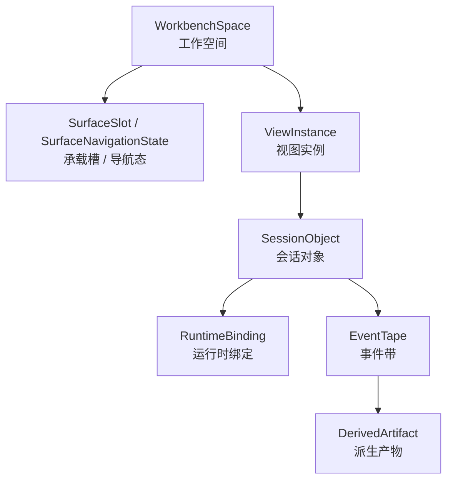
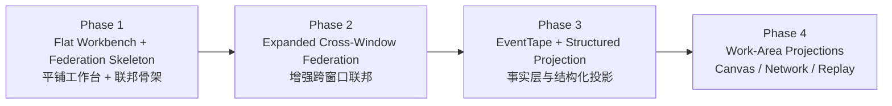

# 产品目的与核心对象

[返回《Agent Workbench 共享工作图谱规格》](../agent-workbench-shared-graph-spec.md)

# Agent Workbench 共享工作图谱架构规格

> **版本**: v0.3-draft  
> **日期**: 2026-03-30  
> **状态**: 待评审（review pending，待评审）  
> **文档类型**: architecture / spec（架构规格）  
> **定位**: 定义 `Agent Workbench（Agent 工作台）` 的产品主对象、共享底层模型、事实源、跨端承载方式、与现有代码的桥接边界，以及首批可直接开工的实施切片。  
> **关联**:
> - Epic: `#728`
> - 讨论笔记: `docs/plans/2026-03-30-agent-workbench-canvas-brainstorm.md`
> - Phase 1 设计: `docs/plans/2026-03-30-agent-workbench-phase1-flat-workbench-design.md`
> - 参考: `docs/architecture/agent-hub-ui-spec.md`
> - 参考: `docs/specs/SPEC-goal-system-v0.3-logic.md`
> - 现有运行时: `crates/exomind-runtime/src/session/types.rs`

---

## 0. 文档契约

### 0.1 这份文档回答什么

这份文档回答的是：

1. `Agent Workbench` 到底是什么产品，不是什么产品
2. 为什么页面主对象必须是 `WorkbenchSpace（工作空间）`
3. 为什么外层要建模成 `container graph（容器图）`，内层要建模成 `shared work graph（共享工作图谱）`
4. 为什么 `EventTape（事件带）` 必须是事实源，结构化解析只能是派生层
5. `AgentNodeObject / TerminalNodeObject / SessionObject / RuntimeBinding / FocusRun` 之间到底怎么分层
6. 现有 `AgentSession / PTY / TimeBlock / AgentsPage / TaskDagPage / routes.tsx` 怎么映射到新模型
7. 哪些地方已经可以开工，哪些地方必须先补桥接层

### 0.2 这份文档不回答什么

这份文档不回答：

1. 像素级视觉稿
2. 插件沙箱与插件市场协议
3. 通用多窗口系统的全部底层实现
4. 每个组件的最终动画与交互细节

### 0.3 术语约定

1. 下文统一使用 `SessionObject（会话对象）`
2. 下文中的“对象”指领域对象，不等于 React 组件，不等于运行时句柄
3. 下文中的 `work area（工作主舞台）` 指中间主工作面
4. `canvas / network / replay` 在本规格中优先表示 `projection mode（投影模式）`，而不是顶层页面产品

---

## 1. 产品目的与设计意图

### 1.1 真实目标

这次设计不是为了继续把 ExoMind 做成：

- 一个通用 terminal manager（终端管理器）
- 一个孤立的 signal topology editor（信号拓扑编辑器）
- 一个只会记笔记的 note app（笔记工具）

真正目标是：

> 用户只打开 ExoMind 这一个软件，就能进入长期持久的工作空间，在里面组织任务、和多个 Agent 对话、挂接 terminal / SSH、查看结果、记录专注过程，并在事后回放与追溯整个工作事实。

### 1.2 必须保留的产品意图

这些意图后续不能被实现细节悄悄改掉：

1. **工作台不是固定三栏**
   - 三栏只能是默认预设，不是底层真模型
2. **工作台不是纯白板**
   - 画布很重要，但它只是工作主舞台的一种投影模式
3. **工作台不是多个互不相通的窗口**
   - 面板、画布、网络图、详情页看到的是同一批对象与事实
4. **工作台不是只围绕单个任务**
   - 工作空间比任务更持久，同一空间里会发生多段专注工作
5. **结构化解析不是事实源**
   - 原始终端流、原始 Agent 流、原始事件流才是事实源
6. **终端能力是底座，不是产品主轴**
   - 产品主轴仍是多 Agent 工作台
7. **Signal Network 不是平行产品**
   - 它应该成为 Workbench 的一种投影视图

### 1.3 一句话定义

> `Agent Workbench` 是一个支持容器自由组织、运行时对象纳管、工作过程记录与回放、并能以多种投影模式查看同一底层图谱的 `containerized work cognition space（容器化认知工作空间）`。

---

## 2. 核心架构判断

### 2.1 两层图必须分开

本次设计的关键，不是多几个对象，而是明确两层图：

1. `container graph（容器图）`
   - 解决“屏幕上怎么排”
   - 是空间级布局模型
2. `shared work graph（共享工作图谱）`
   - 解决“系统里到底有什么对象，它们怎么关联”
   - 是产品语义模型

如果不分开，最终一定会发生：

1. 把对象关系、运行时状态、画布坐标都塞进单一画布模型
2. 把布局状态、业务关系、跨端投影、导航状态都混成 UI 局部状态

### 2.2 `WorkbenchSpace` 为什么必须是主对象

如果页面主对象是 terminal：

- 任务、笔记、结果、Agent 协作都会退成终端附属物

如果页面主对象是 task：

- 多终端、多 Agent、多文档、多专注片段没有稳定宿主

如果页面主对象是 session：

- 长期布局、空间偏好、固定视图、跨多次会话的组织能力无处安放

因此：

> 页面主对象必须是 `WorkbenchSpace`。task / session / terminal / note / result 都是在空间里被组织、呈现和回放的对象。

### 2.3 `AgentNodeObject` 和 `SessionObject` 为什么必须分开

两者解决的是不同问题：

1. `AgentNodeObject`
   - 解决“这个节点在工作空间里是谁、它和别的节点是什么关系”
2. `SessionObject`
   - 解决“这一次实际交互或执行过程是什么、它有哪些历史和输出”

但在用户产品感知层面，二者也不能变成两个并列主对象。  
因此需要同时满足两条规则：

1. **逻辑层分开**
   - 节点与会话是不同对象
2. **产品层收敛**
   - 默认交互入口优先是节点/对象
   - 打开节点时，默认进入当前或最近一次会话
   - 历史 session（历史会话）作为时间视角或二级展开，而不是并列主入口

### 2.4 `EventTape` 为什么必须是事实源

如果把结构化解析结果当事实源，会马上遇到：

1. 解析策略一变，历史就变
2. 终端流和 Agent 流细节丢失
3. Replay / Summary / Timeline / Network 结果不再可追溯

因此必须采用：

```text
raw stream / raw event
  -> EventTape
  -> parser / projector
  -> derived artifacts
```

派生层可以删掉重算，事实层不能静默改写。

---

## 3. 系统总模型

### 3.1 总览

```text
WorkbenchSpace
  ├─ layout profiles
  ├─ surface slots
  ├─ surface navigation states
  ├─ view instances
  ├─ space memberships
  └─ focus runs
       └─ event tape

Shared Work Graph
  ├─ static semantic objects
  ├─ dynamic runtime objects
  ├─ typed relations
  ├─ runtime bindings
  └─ runtime attachments

Derived Layer
  ├─ projection artifacts
  ├─ session summaries
  └─ replay read models
```

### 3.2 Obsidian 速览图





### 3.3 四层分工

#### A. `space layer（空间层）`

回答：

- 我现在在哪个工作空间里
- 这个空间桌面/平板/手机各自怎么摆
- 当前前台工作面是什么

#### B. `object layer（对象层）`

回答：

- 工作里有哪些对象
- 谁是长期对象，谁是运行时对象
- 对象和对象之间是什么关系

#### C. `fact layer（事实层）`

回答：

- 这一段工作到底发生了什么
- 事件顺序是什么
- 哪些结论可以追溯到哪些事实

#### D. `projection layer（投影层）`

回答：

- 这些对象和事实现在以什么方式被看见
- 当前工作主舞台是 `canvas / network / replay` 哪一种投影模式

---

## 4. 核心对象模型

## 4.1 `WorkbenchSpace`

### 定义

`WorkbenchSpace` 是长期持久的工作场景。  
它既不是文件夹，也不是临时过滤器，而是：

1. `anchor object（锚点对象）`
2. `view lens（子图视角）`

### 最小结构

```ts
type SurfaceProfile = 'desktop' | 'tablet' | 'mobile';

type SpaceLayoutProfile = {
  surfaceProfile: SurfaceProfile;
  rootLayoutNodeId: string;
  activePresetId?: string;
  navigationStateId: string;
};

type WorkbenchSpace = {
  id: string;
  name: string;
  scope: 'personal' | 'team' | 'project';
  description?: string;

  layoutProfiles: Record<SurfaceProfile, SpaceLayoutProfile>;
  defaultEntryViewId?: string;
  visibilityRuleIds?: string[];

  createdAt: string;
  updatedAt: string;
};
```

### 语义要求

1. `WorkbenchSpace` 可以长期存在，不随单次会话结束而销毁
2. 一个空间下可以发生多次 `FocusRun`
3. 桌面、平板、手机可以有不同布局根节点
4. 空间视角由下面几类因素共同决定：
   - `space_local（空间本地对象）`
   - `visible_in_space（显式可见对象）`
   - `pinned_in_space（固定对象）`
   - `query / rule-based includes（查询/规则纳入）`

## 4.2 `ViewInstance`

### 定义

`ViewInstance` 是对象的呈现机制，不是产品主对象。  
用户真正干活的对象仍然是 `SessionObject / AgentNodeObject / TerminalNodeObject / TaskObject` 等。

```ts
type ProjectionMode = 'canvas' | 'network' | 'replay';

type ViewTarget =
  | { kind: 'space'; spaceId: string }
  | { kind: 'object'; objectId: string }
  | { kind: 'focus-run'; focusRunId: string }
  | { kind: 'query'; queryKey: string };

type ViewType =
  | 'task-list'
  | 'session-list'
  | 'session'
  | 'conversation'
  | 'terminal'
  | 'browser'
  | 'work-area'
  | 'note'
  | 'inspector'
  | 'outcome';

type ViewInstance = {
  id: string;
  viewType: ViewType;
  title?: string;
  target: ViewTarget;
  defaultProjectionMode?: ProjectionMode;
  sharedState?: Record<string, unknown>;
  createdAt: string;
  updatedAt: string;
};
```

### 语义要求

1. 同一个对象可以被多个视图实例同时查看
2. `sharedState` 只保存跨端共享的语义状态
3. 终端 / 会话 / 对话是工作面，不只是列表条目
4. `work-area` 是中间主舞台；`canvas / network / replay` 是它的投影模式

## 4.3 `LayoutNode` 与外层容器图

### 定义

```ts
type LayoutNode =
  | SplitNode
  | TabsNode
  | PanelNode
  | FloatingNode
  | WorkAreaHostNode;

type SplitNode = {
  id: string;
  kind: 'split';
  direction: 'horizontal' | 'vertical';
  childIds: string[];
  sizes?: number[];
};

type TabsNode = {
  id: string;
  kind: 'tabs';
  childIds: string[];
  activeChildId: string;
};

type PanelNode = {
  id: string;
  kind: 'panel';
  viewId: string;
};

type FloatingNode = {
  id: string;
  kind: 'floating';
  childId: string;
  x: number;
  y: number;
  width: number;
  height: number;
};

type WorkAreaHostNode = {
  id: string;
  kind: 'work-area-host';
  viewId: string;
  allowedProjectionModes: ProjectionMode[];
};
```

### 语义要求

1. 这是单一 `surface profile（端侧布局）` 内的放置真相源
2. `LayoutNode` 只负责同一端内的容器组织
3. `WorkAreaHostNode` 承载中间主舞台，不再直接用 `canvas-host` 命名
4. 对象在 `work-area` 中的坐标与展开状态属于视图状态，不属于对象本体

## 4.4 `SurfaceSlot` 与 `SurfaceNavigationState`

### 定义

`SurfaceSlot` 不再直接重复声明 `viewId` 的放置关系。  
它表达的是：当前端上有哪些承载槽位，以及这些槽位挂哪一棵布局树。

```ts
type SurfaceSlot = {
  id: string;
  surfaceProfile: SurfaceProfile;
  slotRole: 'primary' | 'secondary' | 'detail' | 'transient';
  mode: 'panel' | 'tab' | 'floating' | 'drawer' | 'sheet' | 'fullscreen' | 'window';
  rootLayoutNodeId: string;
  visible: boolean;
  priority?: number;
  localState?: Record<string, unknown>;
};

type SurfaceNavigationState = {
  id: string;
  surfaceProfile: SurfaceProfile;
  activeSurfaceSlotId?: string;
  activeLeafViewId?: string;
  selectionRef?: { kind: 'object' | 'session' | 'focus-run'; id: string };
  openedFromViewId?: string;
  backStack: string[];
  presentationState?: Record<string, unknown>;
  updatedAt: string;
};
```

### 语义要求

1. `LayoutNode` 负责同端容器组织
2. `SurfaceSlot` 负责跨端/跨窗口的挂载
3. `SurfaceNavigationState` 负责：
   - 当前前台工作面
   - master-detail 选择态
   - drawer / sheet / fullscreen 的返回路径
4. `ViewInstance.sharedState` 与 `SurfaceSlot.localState` 必须分开

## 4.5 `WorkbenchObject`

### 基础定义

```ts
type WorkbenchObjectKind =
  | 'task'
  | 'goal'
  | 'document'
  | 'note'
  | 'resource'
  | 'agent-node'
  | 'terminal-node'
  | 'session'
  | 'result';

type WorkbenchObjectBase = {
  id: string;
  kind: WorkbenchObjectKind;
  title: string;
  createdAt: string;
  updatedAt: string;
};
```

### 分类

#### 静态语义对象（static semantic objects，静态语义对象）

1. `TaskObject`
2. `GoalObject`
3. `DocumentObject`
4. `NoteObject`
5. `ResourceObject`

#### 动态运行时对象（dynamic runtime objects，动态运行时对象）

1. `AgentNodeObject`
2. `TerminalNodeObject`
3. `SessionObject`
4. `ResultObject`

## 4.6 `AgentNodeObject`

```ts
type AgentNodeObject = WorkbenchObjectBase & {
  kind: 'agent-node';
  role: string;
  providerKind?: string;
  defaultInteractionMode: 'terminal' | 'structured';
  status?: 'idle' | 'active' | 'warning' | 'error';
  capabilityTags?: string[];
};
```

语义要求：

1. 表示空间中的能力节点/角色节点
2. 不是某次具体运行
3. 默认交互入口优先是节点，节点再解析到当前或最近 session

## 4.7 `TerminalNodeObject`

```ts
type TerminalNodeObject = WorkbenchObjectBase & {
  kind: 'terminal-node';
  transportKind: 'pty' | 'ssh';
  hostRef?: string;
  shellRef?: string;
  status?: 'idle' | 'connected' | 'warning' | 'error';
};
```

语义要求：

1. 终端能力建模成长期对象，而不是临时 PTY 句柄
2. `ssh` 只在 transport 层出现，不在 `SessionKind` 重复编码
3. 当前 `AgentsPage` 中的 PTY synthetic node 不能继续伪装成 `agent`

## 4.8 `SessionObject`

### 定义

```ts
type SessionKind = 'agent' | 'terminal' | 'conversation';

type SessionObject = WorkbenchObjectBase & {
  kind: 'session';
  sessionKind: SessionKind;
  status: 'running' | 'waiting_input' | 'paused' | 'completed' | 'error' | 'archived';
  interactionMode: 'terminal' | 'structured';
  summary?: string;
  lastEventAt?: string;
  createdFromRuntimeModel: 'agent-session-v1' | 'native-workbench-v1';
};
```

### 语义要求

1. `SessionObject` 是一次交互/执行过程的历史容器
2. 允许脱离当前运行时继续存在
3. 与节点的关系通过显式 anchor / relation 建模，不再用裸 `anchorObjectId`
4. MVP 阶段只要求稳定承载 `agent-backed session（现有 agent 会话）`

## 4.9 `SessionAnchor`

```ts
type SessionAnchor = {
  id: string;
  sessionId: string;
  anchorKind: 'agent-node' | 'terminal-node';
  anchorId: string;
  role: 'primary' | 'backing-terminal' | 'origin';
  attachedAt: string;
  detachedAt?: string;
};
```

语义要求：

1. `SessionAnchor` 是 session 宿主语义的真相源
2. 一个 session 可以有多个 anchor，但必须有明确 `role`
3. 迁移宿主时保留历史，不静默覆写

## 4.10 `ResultObject`

```ts
type ResultObject = WorkbenchObjectBase & {
  kind: 'result';
  resultType: 'message' | 'artifact' | 'summary' | 'decision' | 'plan';
  derived: boolean;
  sourceTapeId?: string;
  sourceSessionId?: string;
};
```

语义要求：

1. 若 `derived = true`，必须至少有一个稳定来源
2. 细粒度来源通过 `derived_from` 关系表达，不再把多来源 ID 数组塞回对象本体

## 4.11 `RuntimeBinding` 与 `RuntimeAttachment`

### 定义

```ts
type RuntimeBinding = {
  id: string;
  bindingType: 'pty' | 'ssh' | 'agent-session' | 'browser-runtime' | 'external-process';
  runtimeRef: string;
  status: 'running' | 'idle' | 'waiting' | 'stopped' | 'error';
  metadata?: Record<string, unknown>;
  createdAt: string;
  updatedAt: string;
};

type RuntimeAttachment = {
  id: string;
  bindingId: string;
  ownerType: 'session' | 'agent-node' | 'terminal-node';
  ownerId: string;
  role: 'primary' | 'backing' | 'mirror';
  attachedAt: string;
  detachedAt?: string;
};
```

### 语义要求

1. `RuntimeBinding` 表示运行时资源
2. `RuntimeAttachment` 表示谁在什么时段绑定了这个资源
3. 这是对象与运行时关联的单一真相源
4. 不再让 `SessionObject` 和 `RuntimeBinding` 双向各持一个外键

## 4.12 `FocusRun`、`EventTape`、`TapeEvent`

### 定义

```ts
type FocusRun = {
  id: string;
  spaceId: string;
  timeblockId?: string;
  title?: string;
  status: 'planned' | 'running' | 'paused' | 'ended';
  startedAt: string;
  endedAt?: string;
  eventTapeId: string;
  summary?: string;
};

type EventTape = {
  id: string;
  focusRunId: string;
  createdAt: string;
};

type TapeEvent = {
  id: string;
  tapeId: string;
  seq: number;
  ts: string;
  sourceType: 'user' | 'agent' | 'terminal' | 'system' | 'plugin';
  sourceObjectId?: string;
  sourceSessionId?: string;
  sourceStreamId?: string;
  sourceOffset?: string;
  idempotencyKey?: string;
  eventType: string;
  raw: unknown;
};
```

### 语义要求

1. `FocusRun <-> EventTape` 在 MVP 中是严格 1:1
2. 一个空间同一时刻最多只允许一个 `running` 的 `FocusRun`
3. `ended` 状态必须带 `endedAt`
4. `(tapeId, seq)` 必须唯一
5. `TapeEvent` 追加写入，不静默改写

## 4.13 `SpaceObjectMembership`

```ts
type SpaceObjectMembership = {
  id: string;
  spaceId: string;
  objectId: string;
  isLocal: boolean;
  isVisible: boolean;
  isPinned: boolean;
  createdAt: string;
  updatedAt: string;
  removedAt?: string;
};
```

语义要求：

1. `(spaceId, objectId)` 复合唯一
2. `isPinned => isVisible`
3. `isLocal` 与对象跨空间复用不冲突

## 4.14 `WorkbenchRelation`

### 定义

```ts
type RelationType =
  | 'contains'
  | 'parent_of'
  | 'references'
  | 'derived_from'
  | 'binds_to'
  | 'runs_as'
  | 'produces'
  | 'consumes'
  | 'depends_on'
  | 'blocks'
  | 'delegates_to'
  | 'informs'
  | 'occurred_in'
  | 'active_during'
  | 'replayed_from';

type WorkbenchRelation = {
  id: string;
  sourceId: string;
  targetId: string;
  relationType: RelationType;
  scope: 'global' | 'space';
  scopeSpaceId?: string;
  metadata?: Record<string, unknown>;
  createdAt: string;
  endedAt?: string;
};
```

### 语义要求

1. 这是共享工作图谱中对象边的统一存储模型
2. `SpaceObjectMembership` 不是它的替代品，只是空间可见性专用成员关系
3. 每种 `relationType` 后续需要补端点类型约束与基数约束

## 4.15 `DerivedArtifact`

```ts
type DerivedArtifact = {
  id: string;
  artifactType: 'projection' | 'session-summary' | 'structured-parse' | 'timeline-read-model';
  sourceTapeId: string;
  payload: Record<string, unknown>;
  createdAt: string;
  updatedAt: string;
};
```

语义要求：

1. 持久化的派生产物必须带 `sourceTapeId`
2. 事件级来源通过 `derived_from` 关系补足
3. 派生产物可删、可重算

---
