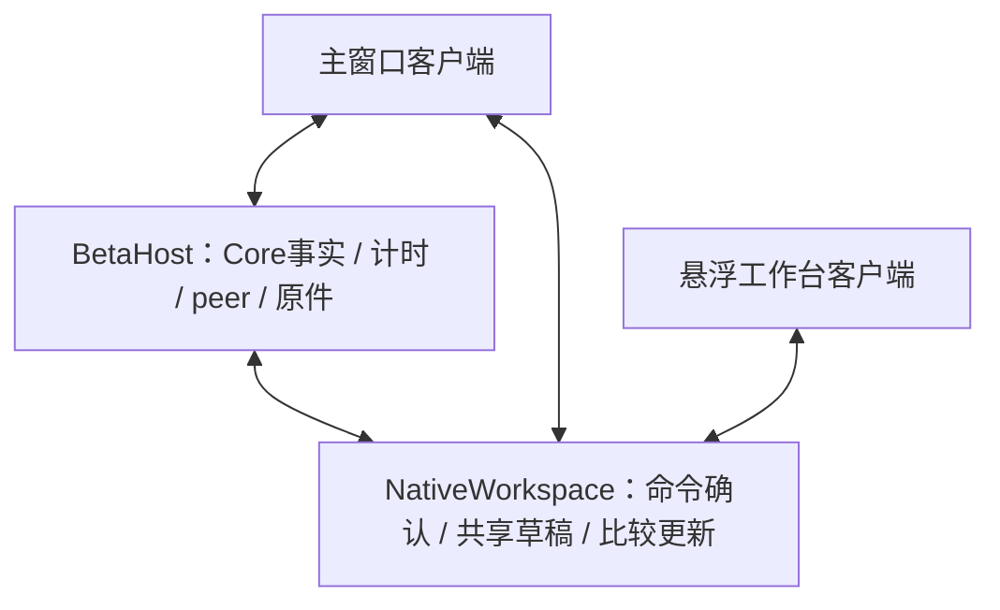

# Beta Native 工作区：窗口只是客户端

主窗和浮窗是两个客户端。Native 工作区持有共享草稿、档案绑定和在途命令，主窗关闭后浮窗仍可使用它自己的档案。这个约定来自 2026-11-18 的用户决定。Beta13 的窗口验收和后续候选记录可分别查阅。[Beta13 窗口记录](../plans/2026-11-18-beta13-shell-and-desktop-feedback.md) · [当前版本状态](../AI-CONTEXT.md)

主窗口没有到浮窗的状态发布箭头。主页面是否挂载、是否展开专注、是否切到其他档案，都不决定 Native 工作区是否存在。浮窗读取当前 Core 投影与本机私有草稿，Native 执行其请求。主窗的领域控制器目前仍是本窗的读写客户端，不能借给另一窗口作为执行器。

## 所有者与边界

| 对象 | 所有者与生命期 | 不得作为启停条件 |
|---|---|---|
| 时间块事实、Native 到点、同步与原件任务 | BetaHost / Native 应用运行期 | 折叠、隐藏、切页、主文档重载 |
| 浮窗命令与共享草稿仲裁 | `NativeState.workspace`，Rust `NativeWorkspace` | 主窗控制器、Web Lock、前端发布心跳 |
| 浮窗档案与传输代际 | Native 的档案绑定；可持久化恢复，显式打开某档案才变更 | 主窗选 P/Q 或重新挂载 |
| 绘制、预览与纯显示查询 | 每个界面自己的观察期 | 不反向获得业务停止权 |
| 主窗草稿镜像 | 本窗控制器；可销毁/重新读取 | 不能覆盖另一客户端更新的共享草稿 |

`beta_overlay_read/request` 在可信浮窗内直接进入 Native；`beta_workspace_bind` 是显式对象选择，主窗正常挂载只同步应用级呈现偏好并订阅已提交事件。浮窗无绑定且存在多个档案时可以自行选择。`beta_overlay_main` 不再登记到生产 invoke handler；旧 TS 主窗执行模型已移入 [历史测试夹具](../../tests/unit/beta/fixtures/legacy-main-overlay-owner.ts)，只保留拒绝语义回归；无消费者的旧 250ms 转发循环已删除，不属于产品装配。

保留 `ui_owner_generation` 这一内部 wire 字段名以兼容解析与已有夹具，其语义已变为 Native 工作区绑定代际，绝不能再由主文档重载生成。Native 仍核对窗口 label、精确 URL/origin、运行实例、设备、档案、代际、顺序、请求体和幂等回执；不是给任意窗口或 HTTP Actor 发放 owner 能力。

## 命令、草稿与失败

Native 在执行 Core 变更前，先保存固定命令和未知结果状态；请求 ID 与 Native 票据固定命令/事件身份。Core 成功后只清理已提交草稿版本，较新的编辑保留。Core 事实库和私有草稿库不冒充一个跨库原子事务：若事实已提交而草稿确认失败，固定命令仍可按回执查证，不能换 ID 重发。

记录标签也属于共享提交快照。Native 浮窗提交从同一份持久草稿读取 tags，旧草稿缺少字段时
按空集合处理，不能固定写空集合让另一控制面丢标签。恢复未知回执时复用原命令中的标签；
用户后来修改的正文和标签由新的 revision 保护。相关实际回归先复现空标签，再在完整
`native_workspace` 五项中验证提交、重试、新稿保留与无主窗口执行；这不替代新候选的浮窗实测。

共享草稿通过 `compare_local_intent` 在 Host 同一个 gate 下比较旧值并写入。主窗持有自己的已确认基线；Native 浮窗持有当前基线。另一方先写入时，陈旧写者得到明确冲突，保留本窗输入，不覆盖新稿。Native 变更只广播 cache key / 已提交档案 ID；没有把草稿正文或凭据放进事件日志。干净镜像可以重读，正在写的本地输入不会被迟到的外部读取替换。

草稿、布局和档案偏好不是 Core 事实，也不参与 peer 复制。权限撤销、真正停止应用与档案领域动作仍按原合同收束；本原则不要求进程退出后继续运行。模板和来源数据未知/损坏时保留原资料并停止不安全写入。

## 观察成本与验收

浮窗正常观察改为约 1 秒一次；用户命令提交后立即读回，不等待下一次周期。旧的主窗 250ms 发布/取票循环已经退出生产装配。主窗读模型仍有 1 秒观察；这部分和 Native scheduler、summary worker、图像与 peer 成本都需单独度量。移除依赖不等于完成能耗优化。

回归入口：Host 的 `tests/native_workspace.rs` 在没有前端/窗口时执行暂停、继续、结束、反馈与文字提交，检查 CAS 与停止；`tests/unit/beta/main-workspace-client.test.tsx` 锁住切主窗档案/卸载不绑定、不发布、不代执行、不撤销浮窗；`presentation-independence` 和 `timeblock-observation` 检查本窗显隐及迟到读取；`local-intent-journal` 检查共享变更与冲突。实际 EXE 还必须覆盖主页面离场、恢复、P/Q 隔离、双向草稿与重复请求。

消息行离场也没有取消原生导出的权力：原生导出由 Native 执行，客户端任务/回执在档案范围保留，搜索只取消该行的观察。当前任务入口保留同一页面运行期最近 32 个终态；整页重载后的完整导出任务管理仍需扩展 Native 查询能力，不能把这轮行级回归扩大为全部生命周期验收。

## Android 符号与构建身份

以往 Android debug 配置显式保留所有 ABI 的原生符号，Beta12 也确为未优化的 debug 候选。生成目录被 Git 忽略，因此修复位于维护源 `scripts/dev/beta-android-prepare.ts`，每次 fresh init 后应用；不是手改生成文件。Beta13 正常调试包保留 Java/WebView 调试能力，交由 AGP 裁剪非装载符号；需要 LLDB 时使用 `-Pexomind.keepNativeSymbols=true`。首个包因 AGP 选择未安装 NDK、缺 strip 工具而没有缩小；维护源进一步共用已安装 NDK 的解析与 Gradle 固定逻辑，准备策略 9 项及 NDK 10 项回归分别通过。

最终 `835d0620` ARM64 包 68,910,081B，`.text/.rodata/.dynsym/.dynstr` 与未裁剪 SO 字节一致，原始 Rust `.so` 已单独归档在仓库外。V2 签名、实际安装哈希、Java/WebView 调试与同源 PC/平板同步均已核验。Windows 同源 22 项实测还覆盖主页面换成无应用代码的图片文档后，浮窗继续读写和计时，主窗重挂/P→Q 不重建或转移其绑定。文件体积、安装占用、运行内存和能耗是不同证据；正式 release 同源对照、长时性能与真机升级仍待单独完成。
