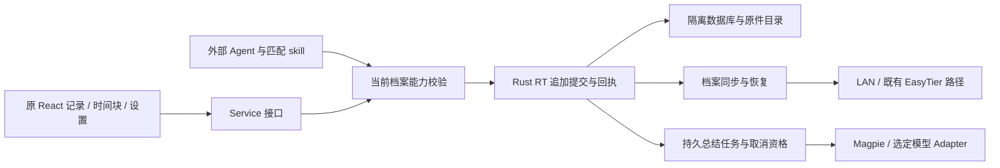

# 外心 0.6 · Beta 功能计划

> 2026-11-13，Asia/Shanghai。状态：**计划交付；Beta 实施等待用户下一条指令。**
> 本轮授权到“修复、验证与收尾 Alpha，完成 Beta 计划”为止，覆盖历史会话中“持续推进实现”的授权。本文交付物、测试和阶段门均为后续实施要求，未因计划写完而成为已实现、已验收。

## 1. 目标、来源与当前断点

Beta 要交付可日常试用的跨设备即时上下文缓冲区：先在本机可靠记下文字、闪念与任意文件，再让同档案设备自动补齐；时间块、反馈与有依据的回顾构成连续使用过程，外部 Agent 能按权限读取和指定追加。用户记录、计时、回看资料时，不需要先掌握 Runtime、网络令牌或同步游标。

裁决顺序保持：**近期亲自回答的需求 > 已核查的 Pro 原型与交接 > 历史 issue > 旧代码。** 27 题已回答，不重开问卷；历史调研中的私人资料、数量、路径和设备地址不进入本计划。

| 来源 | 本计划如何使用 |
|---|---|
| [Q01–Q27 审批与批注决定](2026-11-11-v0.6-approved-decisions.md) | 功能语义的现行决定；自由回答和批注优先于旧选项及 AI 建议。 |
| [r3 执行计划](2026-11-11-v0.6-migration-ui-tauri-validation-plan.md) | 继承 Alpha → B0–B5、U01–U16、D01–D10 和 R01 的来源与责任；本文细化 Beta，覆盖其中仍写作“人类待决”的已回答问题。 |
| [Alpha04 交接](2026-11-12-v0.6-alpha04-handoff-for-gpt.md)、[自动化](2026-11-12-v0.6-alpha04-automated-validation.md)、[release 隔离](2026-11-12-v0.6-alpha04-release-isolation.md) | 复用有明确来源的 PC 基线；不将旧候选测试转移到新代码或 Android。 |
| [原主会话](codex://threads/01a1c4a2-77ce-75d0-bf3e-e911bf4eaf55)、[DeepSeek 收尾](codex://threads/01a1ce16-8ac6-7030-8243-8515d2912eaf) | 对账精简用途、通用原件优先、旧 React 复用、系统入口、配套 skill、PC 人工基线和内部保存点。历史消息作为证据，不扩大本轮权限。 |
| [第二轮会话](codex://threads/01a1d2fb-c96d-75a1-802a-4153c54f518c) 的 11 月 13 日反馈 | Android 事件发送回归、状态获取错误、反复同步和横屏系统栏冲突；同步须按用户叙事参考 EasyTier/T3Code/LocalSend 重写，配对单位为设备上的档案。 |
| `next/` Pro Node 参考原型 | 提炼稳定请求 ID、原件字节、持久回执、游标、覆盖快照、取消和失败夹具；不是正式 Rust 核心，不按原型对象或测试数量决定功能。 |

### 1.1 Alpha 的事实与 Beta 入场条件

Alpha04 PC 人工基线、归档候选 36/36 和 release 双安装目录 68/68 有历史证据；release 隔离绑定 `c8933b14`，其后的历史开发保存点为 `49a96790`。DeepSeek 会话记录、以及本轮 GitHub Actions 回读均确认该提交的四平台验证构建 run `43230230510` 通过；这仍是构建证据，**用户最新 Android 真机失败优先于“CI 绿”的泛化结论**。本轮 alpha05 的精确来源与验证另记，不移用这些历史结果。

本轮修复提交、命令结果、候选身份及未测项见 [Alpha 收尾记录](2026-11-13-v0.6-alpha-closeout.md)。平板已接入诊断，修复候选的真机复验结果以该记录为准，不能预填通过。PC 内部封存、Android 修复候选、Android 真机验收、公开发行和日用入口切换分别处理。

Beta 启动须同时满足：

- [ ] Alpha 修复 diff 与直接回归已复核，源码与内部保存点可回读。
- [ ] 已说明 PC、Android 实际验证范围；仍失败或无设备验证的行为不得写成通过。
- [ ] 新版与日用 0.5 的 AppData、Runtime、WebView、配置和档案隔离。
- [ ] 用户发出 Beta 实施指令。**本轮不执行 B0 或 R01 修复，不创建 Beta 核心代码。**

## 2. 用户叙事与范围

| ID | 用户要完成的事 | 可见结果 | 主要阶段 |
|---|---|---|---|
| S01 | 我离线也能先把想法和文件记下，稍后继续输入。 | 本机保存回执；失败保留草稿，旧回执不会清掉新内容，重启可读。 | B1 |
| S02 | 我把手机加入电脑正在用的档案，以后打开就能接着看。 | 一次完整邀请与确认；同档案、已授权设备自动补齐，不需反复点击同步。 | B2 |
| S03 | 附近有人也在用外心，但不能看见我的资料。 | 同名档案仍隔离；发现、网络可达都不能获得业务权限。 | B0、B2 |
| S04 | 出门、切网或开 VPN 后，我仍知道哪些内容在本机、哪些已到另一端。 | 身份不随 IP 改变，自动重连；文字与原件状态分开，失败给可操作原因。 | B2 |
| S05 | 文件很大时先同步记录，真正要用再取原件。 | 元数据和来源可见；小文件自动，大文件按需，源离线明确提示，不假称已收到。 | B1、B2 |
| S06 | 我开始、暂停、切换和结束一段时间，并保留反馈。 | 正倒计时、空余块、结束与反馈阶段；两端冲突保留来源、收敛为可解释时间线。 | B1、B2、B3 |
| S07 | 我回顾一段时间，知道总结依据了什么，并能控制更新。 | 首次自动总结、手动分界压缩、引用与覆盖缺口；取消有效，迟到输入提示按需更新。 | B3 |
| S08 | 我让外部 Agent 查资料、导出，或在当前档案追加说明。 | 有范围的读/写能力，human、agent_note、summary 区分，缺件和分页均可知。 | B3、B4 |
| S09 | 我快速呼出、录音、看图片、切横屏，然后继续原来的记录。 | 原 React 暖石界面、草稿与滚动保留；原声先保存；全屏开关和系统栏不遮挡。 | B1、B4 |
| S10 | 我整理空间、导出有价值的内容，必要时只释放本机副本。 | 显式回收、恢复、彻底清理；派生结果与来源痕迹保留，其他端副本不被暗中清掉。 | B4 |

完整 Beta 包含：新数据只增记录与标签、通用原件、检索、时间块与反馈、同版本 Windows/Android 同档案同步、回顾和模型配置、Agent API/skill、媒体基础呈现、设置、导出及手动整理。B1/B2 局部工程检查点可以独立评审，但不能替代 Q01 要求的完整日常 demo。

本阶段不建设：独立任务/目标/提案/终端会话管理、复杂云端账号服务、0.5 导入或协议兼容、跨端草稿、自动遍历播放列表引用资源、双向知识库同步、自动清原件、主动压缩提醒、自主 life tick、内置积分/配额平台。二维码、内嵌 EasyTier 管理、WinCraft 替代宿主、Reticulum/DSON/插件平台均不作为 Beta 前置。

## 3. 同步重写：先拆需求，再选机制

### 3.1 连接过程中的独立事实

主路径只有“在 P 上生成完整邀请 → 另一设备确认加入 P → 自动补齐”。已有非空 Q 档案不能因名称一样或接受邀请就被改 ID、并入 P；应保留 Q，在明确选择后创建/加入 P，再切换当前档案。首次加入不是把两个不同档案强行配成同档案。

| 事实 | 要回答的问题 | 失败时保留什么 |
|---|---|---|
| 发现 | 找到哪些候选设备/端点？ | 不含正文、凭据或其他档案列表的最小发现信息；可关闭发现。 |
| 身份 | 是原来那台设备及其 P 成员吗？ | 稳定设备身份和密钥；IP、名称和自报 ID 不能单独证明身份。 |
| 档案与授权 | 当前双方是否属于同一个 P，具有什么能力？ | P 的成员授权、撤销状态；同名和同网段不能越权。 |
| 可达 | 当前用哪条地址能访问已验证的对端？ | LAN/EasyTier 等候选路径和有界退避；不因换 IP 丢配对。 |
| 本机提交 | 这次输入是否已持久保存？ | commandId、payload 摘要、持久回执和附件提交快照。 |
| 对端补齐 | 对端有哪些事件、原件已持久化？ | 事件游标、缺件清单与原件验证回执；健康 200 不能代替。 |

UI 主状态用“本机已保存 / 对端待补齐 / 记录已补齐、原件按需 / 原件已收到”等动作结果。连接详情展开诊断；不可达、身份变化、档案不匹配、授权撤销、协议不兼容、存储失败各有独立错误码，不把技术栈名塞进日常采集流程。

候选列表须区分对方当前使用的档案与本机 P 的关系；未授权时不广播其全部档案清单。同名异 ID 显示为不同档案，先完成明确加入，才可建立业务同步。当前档案尚未选择/加载时，记录入口给出选档案或重试入口，不能把本机上下文错误统称网络失败。切换 P→Q 时，旧请求、草稿与回执保留 P 归属，不能写入或清空 Q 的输入。

### 3.2 检索路线与来源选择

先核对 ExoMind 审批、r3、Alpha04 证据和 `next/`：当前产品仍是旧代 RT/Mesh，不能把 Node 双实例原型说成新同步已经可用。再检查 [cross-analysis 本地索引](../../skills/cross-analysis/references/index.md)：尚无这三个对象的专用档案，终端/笔记/设置类档案不足以回答本轮配对与可靠传输问题，因此补读三个官方开源项目；没有新增或维护参考源库。

以下为 2026-11-13 实际读取的只读快照；只提炼相关边界，不声称实测了三者客户端，也不把文档描述等同于本机安装版。

| 参考源与实现位置 | 与本轮相关的事实 | 借鉴与不照搬的边界 |
|---|---|---|
| [EasyTier README，`0009db4`](https://github.com/EasyTier/EasyTier/blob/0009db4c226b3c34b0ec5350ec9dfba83252f5da/README.md) | 提供虚拟网络、NAT 穿透、P2P/中继和路由；相同 network name/secret 用于加入同网络。 | 复用已建立的可达路径。网络成员资格不能代替外心档案授权或数据回执；不要求再建一套 VPN，也不预先决定嵌入该库。 |
| [T3Code remote architecture，`08544ba`](https://github.com/pingdotgg/t3code/blob/08544ba3e59c7b5e718e2348e7bb5c44a7575fae/docs/internals/remote.md) | 稳定 environment 身份与可变路线分离，peer link 有显式授权/撤销，换路线前验证身份和授权。 | 借鉴一次授权、路线恢复、停止所有权。它主要连接远端执行环境，不能照搬成多写者数据复制协议。 |
| [LocalSend protocol v2.2，`62bd340`](https://github.com/localsend/protocol/blob/62bd3406ec80d62f2ed46269cdc06c4dcc391083/README.md) | 发现有多路径；文件元数据准备与字节上传分开，session/文件 token、取消、hash 校验分开定义。 | 借鉴低摩擦发现、先协商后传输、明确文件结果。它是文件传送参考，不提供外心档案成员、事件合并或持久反熵合同。 |
| [T3Code composer，同快照](https://github.com/pingdotgg/t3code/blob/08544ba3e59c7b5e718e2348e7bb5c44a7575fae/docs/user/composer.md#attach-files) | 上传完成才发送，失败可重试或移除；附件接纳与消息提交分开。 | 借鉴在途状态和操作。面向模型处理媒体的限制/转换，不作为外心原始字节保存规则。 |

交叉结论属于本计划的工程判断：**可达性、应用授权、数据持久化必须分层**。EasyTier 解决可达路径，T3Code 提示身份/授权/路线边界，LocalSend 提示接纳与文件传输状态；外心仍需自己实现按档案的追加事实合并、每对端游标、持久回执和缺件恢复。发现失败应有完整邀请地址作为退路，不将大范围网段扫描设为必做步骤；首配成功后不要求重复配置入站/出站 token 或反复手动同步。

## 4. 最小架构与数据合同

沿用 [分层原则](../architecture/overview.md)：React/Zustand 只经 Service 使用业务能力；业务接口由稳定一侧定义；存储、HTTP/IPC、网络路径、平台文件与模型供应商进入明确 Adapter 边界。正式 Rust RT 拥有提交、事务、同步游标和任务资格。Tauri 负责宿主生命周期，Web 负责呈现与本机草稿，Node 只留作参考夹具。



### 4.1 身份、权限与协议

| 对象 | B0 必须冻结的合同 |
|---|---|
| 档案 P | 随机生成全局唯一 `profileId`，原子持久化；名称仅显示。常态一个档案，结构允许多个。标签不参与授权。 |
| 设备 | 持久 `deviceId` 和身份密钥，不因端口、IP、名称、升级变化；新装/恢复身份有显式规则。数据备份不能让两个同时运行的设备冒用同一写入身份。 |
| 设备上的档案 | 成员键含 `profileId + deviceId`；每个成员有独立能力/凭据/撤销状态。P 的授权不能读取同设备 Q。 |
| 邀请与配对 | 完整邀请携带目标身份、档案、协议、候选地址、有效期和一次性加入材料；验证后显式确认，防重放、限次、到期/撤销可见。凭据不进日志或普通 URL query。 |
| 加入恢复 | 空白端加入既有 P；已有不同档案保留。配对半途断网可查证或幂等重试，不残留“登记成功但没有出站权限”的假配对。 |
| 协议 | 首个 Rust 版明确 protocol/schema/capabilities；首要保证精确同版本 Windows/Android 互通。不同 schema 拒绝写入并说明升级，不能尝试旧 0.5 协议或隐式转换。 |
| 认证 | LAN 与 EasyTier 路径均验证应用身份与档案能力；TLS/受信通道部署与密钥保管由 B0→B2 夹具检验，未知证书/身份变化不自动接受。未认证端点只返回最小描述。 |

### 4.2 追加记录、回执、原件与派生

- 记录包含稳定 `eventId`、`profileId`、来源设备、作者类别、时间和 payload 摘要；更正、回收、恢复追加新事实，原文不覆盖。相同 ID/相同内容幂等，相同 ID/不同内容拒绝并形成冲突证据。作者归属取自认证上下文，外部 Agent 不能靠请求参数冒充 human；外部追加的总结也保留外部来源。
- UI/Agent 的 `commandId` 绑定当前档案、调用者和固定 payload；提交事实与回执同事务。断线丢回执时查询或同 ID 重试得到原结果；显式冲突不能靠随机换 ID 掩盖。
- 本次提交拥有不可变文字与附件清单；新草稿和上传队列使用另一份状态。固定整组原件本机验证就绪后提交，可先移除失败项再形成新快照；大文件可分条。成功只清理对应快照，不能清掉后来输入。
- 通用原件按内容 hash/长度校验，保留原文件名、类型与引用关系；临时字节、完整字节、数据库引用有崩溃恢复顺序。未完成、空间不足、权限失败、缺件不能显示保存成功；读取/下载使用真实原始字节，不拿缩略图替代。
- 小文件按可配置阈值自动复制，大文件元数据先行且按需取回；本机已保存与对端持有两种回执分开。相同字节可去重，但引用、授权与释放副本仍按档案检查，不能用 hash 跨档案猜读。
- 图片预览、转码、ASR、音频理解与总结是独立派生对象，记录来源 ID、处理参数/模型、状态和覆盖快照。未知格式仍可保存/下载；不递归收集引用资源，不自动执行附件。

不变量与用户语义对应：只增事实 → 更正也留痕；本机回执 → 已可靠记下；对端原件回执 → 另一端确实持有；只释放本机副本 → 其他端保留；来源已清理 → 回顾仍能说明缺口。显式彻底清理针对授权范围内字节，仍保留最小事实痕迹，不借“不可删除”无限留存原件。

### 4.3 同步、冲突和恢复

1. 本机追加不等待对端。每个档案成员维护自己的有序追加流及恢复代次；同步使用稳定身份和每对端持久游标，分页事实及游标在接收端同事务提交。WebSocket/通知只负责唤醒补齐，不能成为唯一事实通道。
2. 重放、重复通知、断网、ack 丢失可重复执行；同 ID 异内容、游标越界、对端重置/代次变化分别拒绝或进入显式重建流程，不能静默清零、覆盖或丢页。
3. 双端离线各自写入后保留两个来源。合并按稳定 ID 去重；分页顺序与时间线展示顺序分开，时钟偏移不能让事件掉出同步范围。
4. 文字/事件优先于大文件队列。原件传输有独立进度、hash 验证、失败退避、断点或可解释重试；收到元数据不提升为原件完整。来源离线、已释放或全端缺失均可显示。
5. 切网、回前台、启动时自动触发有界补齐；后台可暂停，前台能恢复。Android 被系统终止不承诺熄屏即时传输，但已提交资料必须仍在，恢复后无需重新配对或反复手动同步。
6. 撤销成员后拒绝新的读写/同步与在途提交资格；已被其他端保存的历史副本无法由“撤销”承诺远程抹除。成员暂停、撤销和释放副本分开。
7. 回收/清理事实参与同步。旧分页或长期离线端不能无意复活已清理的本机副本；另一端仍持有时，可显式取回并保留新动作痕迹。资料恢复与设备身份恢复分别检查，先隔离副本验证再提升为可写实例。

## 5. 时间块、回顾与模型任务

时间块由开始、暂停、恢复、切换、结束、反馈等追加节点切出；保留空余区间，不恢复独立任务规划域。显示时钟读取 RT 状态并本机投影，不让 React 定时器决定业务完成。正倒计时、主窗/浮窗一致性与重启保留要重新验。

两端并发开始/结束时保留全部真实节点。B0 冻结确定性排序：因果关系优先；无法区分因果的并发按稳定事件键打破平局；物理时间仅用于区间位置及异常提示。所有端从同一事实集投影同一条时间线，在任意时刻选择一个活动区间；重叠来源、时钟偏差与裁决原因可追查，不用“较晚时间戳获胜”吞掉另一端行动。

结束进入原反馈流程，行动结束、反馈待填/已提交、总结生成分别显示。日/周/月视图是同一轮转时间线投影；专注浮层收起/展开保持 Chat 挂载、输入草稿、滚动锚点与列表几何。

总结由 RT 持久任务管理，首次在符合条件的时间块结束/反馈后自动生成。首版工程路线为：触发设备创建稳定任务 ID 并记录 ownerDeviceId，其他设备只同步任务事实和结果；默认不自动争抢模型执行，显式接管才产生新 run 和提交资格。未配置供应商时进入等待配置，不借用其他职责的模型配置。B0 用双端重放/重启夹具冻结触发去重键、接管代次和状态规则，不能仅凭任务 ID 声称已解决双端重复付费调用。默认叙述，建议按需配置。状态含等待配置、排队、运行、重试等待、成功、失败、已取消；有限重试耗尽后手动继续。上游决定配额，本产品不建设费用平台。

每次任务冻结来源 ID、读取范围/游标、反馈和已授权材料清单；超过页限、读取失败、仅有元数据、原件未读及远端未补齐均明示。来源 ID 必须真实存在，事实与推断分开。取消/宿主停止/生命周期更换后，旧 run 迟到结果不得提交；重启恢复任务也必须重新取得提交资格。

迟到新记录只标记覆盖变化并给更新入口，新版本不抢走正在读的旧结果。手动选择时间块分界压缩为总块或消息，生成新派生对象并保留原文和引用。文字可按已配置职责自动处理，原件正文仅按需选择给模型；“Agent 可读”不等于允许自动外发媒体。

## 6. 可评审实施批次

依赖顺序：`Alpha 保存点 + 用户启动指令 → B0 → B1 → B2 → B3 → B4 → B5`。每个单元形成独立可复核 diff、相关失败/通过测试和证据；不把所有阶段塞进同一 PR。每阶段最多同时两个职责互不重叠的子 Agent，主 Agent 复核 diff、测试和运行结果；重构、构建和真窗按机器资源门禁串行。

| 单元 | 交付与责任边界 | 完成门与证据 |
|---|---|---|
| B0.1 需求与合同 | 将本文身份、能力、记录/原件、回执、游标、时间线、任务、清理恢复合同落成 Rust/TS 接缝和协议文档；记录旧 issue 的保留/取代/后置。 | 27 题有实现归属；同名异档案、半配对、重放、代次变化、时钟偏移、迟到输出有合成输入和期望；不要求用户选库。 |
| B0.2 原型反例 | 将 Pro 合同转为生产夹具；先用失败测试复现 R01 的 A/B 附件提交及新草稿被旧回执清除。 | 上传 A 期间移除/另加草稿项，固定提交 A/B 不丢，新草稿保留；未配置模型/未配对不假成功。仅修必要参考路径，不把 vanilla 页当产品 UI。 |
| B0.3 平台接入方案 | 明确 Rust 新模块与旧 RT 隔离接缝、IPC/HTTP 入口、Android 存储及前后台所有权、认证通道和配置默认值。 | 导入关系、禁用域 allowlist、独立 root、身份初始化与平台故障夹具可审；无 0.5 隐式读取或兼容回退。 |
| B1.1 记录与查询 | Rust 新数据本机追加、持久回执、分页/搜索/标签；旧 Chat/输入框接 Service。 | V01–V03；丢回执重试、同 ID 异内容、空/错/未载区分，关闭重启保持内容及位置。 |
| B1.2 通用原件 | 原件暂存/提交/读取、hash、固定整组提交、本机草稿恢复、缺件状态。 | V04–V05；未知扩展名和二进制逐字节相等，断电/权限/磁盘满不冒充完成，真实输入 UI 可操作。 |
| B1.3 时间块事实 | 新状态节点、正倒计时、反馈及主/浮窗同源；日周月投影基本数据。 | V10；开始/暂停/恢复/结束/反馈/重启及并发夹具通过，任务域无写入。 |
| B2.1 首配与隔离 | 设备上的档案成员、完整邀请、一次确认、撤销；LAN/EasyTier 候选路线与自动重连。 | V06–V07、V13；PC 双 RT 再 EasyTier 再 Android；空白加入/非空保留、同名异档案、过期邀请和身份改变均验证。 |
| B2.2 事件与原件复制 | 每对端游标、反熵补齐、缺件队列、流量优先级、可查询回执、半配对恢复。 | V08–V09；双方离线写、重复/乱序/丢 ack、分页中断、原件损坏，ID/payload/hash/游标逐项一致。 |
| B2.3 真实移动使用 | Android 本机 RT、LAN/EasyTier/VPN 与 TUN 对照、切网、熄屏/后台、进程回收及前台恢复。 | V11–V13；真实 APK/设备/ADB，离线本机写入与恢复自动补齐；手机浏览器看 PC 不算本机实例。 |
| B3.1 总结与压缩 | 可追查快照/coverage/evidence、首次自动回顾、手动分界压缩、迟到材料提示更新。 | V14；跨分页与缺件材料逐条核对，原文仍在，旧总结稳定、更新另存。 |
| B3.2 模型任务 | RT owns 任务、限次重试/退避、取消/重启资格；Magpie/模型配置 Adapter。 | V15；先可控 mock 再真实模型，失败不丢记录；请求材料范围、质量、用量依据有记录。 |
| B3.3 Agent API/skill | 新协议能力描述、分页/等待/回执、原件读与导出；当前档案按类型追加。 | V16；真实外部 Agent 读合成资料/授权追加，错档案/只读/撤销/未知能力拒绝，无隐式清理。 |
| B4.1 媒体使用 | 原件底座上图片粘贴/预览、录音/回放、视频按需播放，可选 ASR 与边录边转。 | V17；未配置/识别失败原声可存可播；派生引用和未读边界准确，未知格式仍下载。 |
| B4.2 原界面与系统入口 | 日周月、搜索锚点、轻量记录动作、设置 registry、专注浮层、热键/托盘/关闭隐藏；Android 全屏与安全区。 | V18–V19；沿用旧 token/字体/布局，IME/触摸/键盘/减少动效/横竖屏真实验证；WinCraft 无实证不移除浮窗。 |
| B4.3 导出与整理 | 选事件/块导出 Markdown+manifest+已持有原件；回收/恢复/显式清理，本机释放与可选跟进。 | V20；导出 ID/hash 和缺件对账；恢复/清理传播明确，派生/引用不牵连，私人手写区无写入。 |
| B5.1 完整故事验收 | S01–S10 串成同版 Windows/Android 日常流程，重跑 Alpha 原生边界及 Beta 恢复矩阵。 | 全部适用 V01–V22 有真实证据；失败/未测逐项列出，不用统一百分比掩盖手机或模型缺口。 |
| B5.2 编号候选与交接 | 独立 beta01 起的候选、commit/hash、协议/skill、恢复说明、脱敏记录和保存点回读；可直接打开的 HTML 说明/离线模拟与可启动的真实本地链路分开交付。 | V21–V22；HTML 合成模拟明确标注，不能替代 Rust/设备实测。内部保存、公开 preview/formal Release、Pages/下载页及日用入口分别裁定；本计划不自动授权后两者。 |

B0 不建设完整抽象平台。默认沿用当前成熟持久化与平台设施，通过最小模块隔离新语义；引入新依赖、传输或 schema 须指出其解决的已测缺口，检查许可证/平台/升级成本，并给出能回退的接缝。

## 7. 验证矩阵与判定方法

每项从“计划”开始，只能凭指定层实际证据改为通过。浏览器模拟、Node 参考测试、Rust 合同、Windows 原生、Android 真机、真实模型分别记录；一层绿灯不覆盖另一层。

基准夹具使用合成数据：两设备 A/B、同档案 P、同名异 ID 档案 Q、至少 250 条且超过两页容量的事件、混合小文件和一个大于自动阈值的文件、并发时间块及可控迟到模型。**数量是工程测试负载，性能承诺仍需测量。** 固定故障种子及输入清单，比较 ID 集、规范 payload 摘要、原件 byte/hash、游标和回执，禁止只比较数量。

| ID | 必须操作的场景 | 判定标准与证据 |
|---|---|---|
| V01 | 未配对/完全离线本机文字，保存、刷新、停止重启。 | 已确认提交 0 丢失、0 重复；UI 与自有数据库回执一致，不依赖远端在线。 |
| V02 | 提交已生效但丢回执，同 ID 重试；再同 ID 改内容。 | 重试返回原事实；改内容明确冲突，原文不变；新草稿保留。 |
| V03 | 超过两页历史/检索，错误、空、未加载、返回列表。 | 无漏页/重复；错误不假空；锚点/草稿/引用可恢复。 |
| V04 | A/B 附件固定整组、上传中编辑下一稿、失败项移除重试。 | 本次快照不可变；0 跳过/误清；原始文件名、长度、hash/bytes 相等。 |
| V05 | 写文件/rename/提交前后中断、磁盘满和权限拒绝。 | 重启无“已保存却缺件”；未确认输入可恢复或明确可重试；残留不靠隐式删业务数据处理。 |
| V06 | 完整邀请、重复领取、到期、半配对重启、非空 Q 加入 P。 | 正常一次复制+确认后自动补齐；重试幂等；Q 不改 ID/不混入；凭据完整且不泄漏日志。 |
| V07 | 同名异档案、同网不同用户、改地址冒充、撤销及旧 token。 | 未授权读写/原件访问 0 成功；撤销后的在途提交被拒；诊断准确。 |
| V08 | 双 RT 各离线写、跨页、重放/乱序/丢 ack，单端同步重启。 | 双端最终事件 ID+payload 全等，0 漏/重；游标只越过已持久事实；无反复手点同步。 |
| V09 | 小/大原件、下载中断、坏 hash、源端离线/释放，传大文件时记文字。 | 小文件自动；大文件按需；坏件不提升状态；文字不被文件队列长期占死；最终 bytes 相等。 |
| V10 | 正倒计时、反馈、空余块、双端并发/时钟偏移/重启。 | 所有事实保留，投影确定且端间一致；任一时刻一个区间，重叠原因可解释。 |
| V11 | Android 飞行模式本机记录、强制回收重开、再恢复网络。 | 本机确认内容仍在；无需重建档案/配对；返回前台自动补齐。 |
| V12 | Android 熄屏/后台/回前台、Wi-Fi 变化、VPN 开/关、TUN/非 TUN 对照。 | 各网络格单列真实路径与失败原因；恢复前台可自动补齐；不将平台休眠解释为已送达。 |
| V13 | 精确同版 Windows↔Android fresh 与 Beta→Beta upgrade。 | 两种安装态各完成 V01/V06/V08/V09/V11；升级保留 Beta 数据/成员身份；0.5 不读写。 |
| V14 | 总结跨页、缺原件/未授权媒体、迟到反馈、手动范围压缩。 | 来源 ID 可查、缺口真实；旧结果稳定；按需更新另存；原文不删除。 |
| V15 | 模型未配置、超时/限流、取消、重启、旧 run 晚到；真实模型完整流程。 | 状态可见；取消/旧生命周期 0 迟到提交；实际请求范围、输出和可得用量有依据，不输出密钥。 |
| V16 | 真实外部 Agent 分页/读件/等待/导出/分类追加，越权反例。 | 正确档案/能力可用；错实例/档案/只读/撤销/未知能力拒绝；读取不引发清理写入。 |
| V17 | 图片粘贴、未知文件、音视频回放、ASR 失败/重试。 | 原始字节始终可读；派生状态独立；未读媒体不出现在总结理解声明中。 |
| V18 | Chat 与专注浮层、日周月、搜索、IME、输入中返回、390px 与触摸。 | 原布局/字体/token 有来源；草稿/滚动/焦点保留；横向无意溢出和遮挡为 0。 |
| V19 | Windows hotkey/tray/关闭隐藏/退出/DPI/Alt-Tab；Android 横竖屏、键盘、安全区、全屏。 | 真实容器无控件被系统栏遮挡；设置持久且返回前台重应用；退出只释放自有实例。 |
| V20 | 导出有/缺原件、回收恢复、本机释放、显式他端跟进、清理后离线端回归。 | manifest 对账；0 越范围删除；原件清理不删派生；旧重放不无意恢复已清理副本。 |
| V21 | 独立 root 与旧版诱饵；候选重启/恢复/升级失败。 | 日用 0.5 与无关目录无写入；失败保留原库；新 schema 不强行用旧二进制打开，备份恢复单独验证。 |
| V22 | 精确候选构建、运行版本、源码、协议、skill、哈希与远端回读。 | 身份相互匹配；四平台构建单独列；未通过真机或模型不能宣称完整 Beta/公开发行。 |

V08/V11/V12 在受控网络恢复后连续观察完整补齐，记录首次重连、全部事件提交、原件可读的原始耗时；每种核心故障至少用固定输入重复 3 次，要求 0 数据丢失、0 重复和 0 非预期手动同步。延迟分位数须在独立基线有足够样本时报告，并附样本量，不从三次故障试验推断可靠性概率。测试必须有有限超时；具体延迟目标在 B0 采集 LAN/EasyTier/目标设备基线后冻结并写入执行证据，不能把未经测量的“即时/99.9%”包装成用户承诺。超时即该次失败，不能无限等待后补写通过。

现有基础命令可复用：

```powershell
# 根目录：类型与 Web 构建，先于原生验证
npx tsc --noEmit
npm run build:web

# 定向行为测试：实施时使用实际新增/改动的测试选择器
npx vitest run <相关测试路径>

# Node 参考合同检查；只证明参考层
npm --prefix next run verify

# Rust RT/宿主按改动选择，资源受限时单任务
cargo test -p exomind-runtime --test <相关集成测试名> --locked -j 1
cargo test -p exomind --lib --locked -j 1
```

尖括号是实施后必须替换的选择器，不是当前已存在或执行过的测试。B0 为每个 V 项确定实际命令/夹具及产物位置；后续按 Web/行为 → Rust → Edge 真浏览器 → 原生/Android/真实模型推进，测试不读写日用资料。

## 8. Q01–Q27 与批注追踪

| 裁决 | 落地位置 | 对应验收 |
|---|---|---|
| Q01 足够日常能力再试用 | S01–S10、B5，局部检查点不称完整 Beta | V01–V22 |
| Q02 档案隔离、标签用途视图 | §3、§4.1、B1.1/B2.1 | V03/V06/V07 |
| Q03 只增更正 | §4.2、B1.1 | V01/V02 |
| Q04 回收后显式清理 | §4.3、B4.3 | V20/V21 |
| Q05 完整邀请、二维码后置 | §3、§4.1、B2.1 | V06/V13 |
| Q06 前台即时、后台最终一致 | §4.3、B2.2/B2.3 | V08/V11/V12 |
| Q07 轮转事件与空余块 | §5、B1.3/B2.2 | V10 |
| Q08 结束进入原反馈 | §5、B1.3 | V10/V18 |
| Q09 手动分界压缩 | §5、B3.1 | V14 |
| Q10 叙述默认、建议可配 | §5、B3.1/B3.2 | V14/V15 |
| Q11 当前档案 Agent 分类追加 | §4.1、B3.3 | V07/V16 |
| Q12 有限重试、配额交上游 | §5、B3.2 | V15 |
| Q13 播放列表只存所选文件 | §4.2、B1.2/B4.1 | V04/V17 |
| Q14 文件阈值/条件策略 | §4.2、B1.2/B2.2 | V05/V09 |
| Q15 原声优先、按需 ASR | §4.2、B4.1 | V17 |
| Q16 选事件/块导出、Agent 可读 | S08/S10、B3.3/B4.3 | V16/V20 |
| Q17 记录主界面、专注浮层、日周月 | §5、B4.2 | V18 |
| Q18 原 React 暖石风格 | §4、B1/B4.2 | V18/V19 |
| Q19 自己动作短反馈、后台聚合 | §3.1、B4.2 | V02/V08/V18 |
| Q20 复用快速聚焦设置 | B4.2 | V19 |
| Q21 本机草稿自动存、显式提交 | §4.2、B1.2 | V02/V04/V18 |
| Q22 固定整组、可移除失败项 | §4.2、B0.2/B1.2 | V04/V05 |
| Q23 大原件按需、小件自动 | §4.2、B2.2 | V09 |
| Q24 本机释放、他端显式跟进 | §4.3、B4.3 | V20 |
| Q25 保留派生与来源痕迹 | §4.2/§4.3、B4.3 | V14/V20 |
| Q26 迟到材料提示按需更新 | §5、B3.1 | V14/V15 |
| Q27 文字自动、原件按需给模型 | §4.2/§5、B3.2/B4.1 | V14–V17 |

批注与补充要求同样有归属：通用文件先于媒体适配 → B1.2/B4.1；旧 React 的组件、布局、字体、暖石主题与设置直接复用 → B1/B4.2；T3Code composer → B0.2/B1.2/B4.2；最终一致同步 → B2；热键/托盘/关闭隐藏和配套 skill → B3.3/B4.2；需求优先级和脱敏 → §1/§10。最新“设备上的档案”与同名隔离 → §3/§4.1；Android 全屏与安全区 → V19。旧网页模拟视觉和“已读”勾选不构成工程验收。

## 9. 风险、工程默认与待验证事实

| 风险/未知 | 谁在何时解决 | 决策或失败退路 |
|---|---|---|
| Android 基本发送与状态回归不能由 PC 证明修好 | 本轮 Alpha 收尾先修，B2.3 再验证新核心 | 保留设备失败结论和修复候选；无设备不填通过，不归咎 VPN。 |
| Android 后台与 VPN/TUN 的真实限制 | B0.3 能力调查，B2.3 设备矩阵 | 先保证离线本机保存与前台恢复；暂停原因可见，不增加一套强制 VPN。 |
| 身份/凭据与两端非空档案误合并 | B0.1、B2.1 | 同名不合并，完整邀请加入；身份变化进入验证，现有档案保留。 |
| 新核心旁路重新激活旧后台管理域 | B0.3、每次宿主回归 | allowlist 与禁止写入测试；新接口明确失败，不回退旧任务/提案/会话。 |
| Windows 文件持久化与 DB 提交之间崩溃 | B1.2 | 实际磁盘故障/重启证据；未完成状态可恢复，不能引用不存在原件宣称成功。 |
| 长期离线、恢复副本、游标代次变化 | B2.2、B4.3 | 显式重建/对账、保留痕迹；不能用清库/重配解决丢失。 |
| 模型多端重复执行与取消晚到 | B0.1、B3.2 | 定义触发归属/去重及 run 资格；模型侧重复调用与本地提交分别记录。 |
| Beta 候选 schema 升级与回退 | B0.3、B5 | Beta 自身升级有备份/迁移/恢复测试；二进制回退不等于数据可向后打开，禁止覆盖原库。 |
| 内存/磁盘/本机链接风险 | 每个原生构建前 | 资源门禁、单任务、编号独立产物；优先 CI packaging，不重建已充分验证的无关候选。 |

自动原件阈值、并发传输数、分页量、重试次数/退避、回收期提示和时间线跨度是**可调整工程默认**，B0 经目标设备量级及故障基线确定后写入单一配置源和执行记录；不是用户未答题，也不需要再问一次。默认不能授权自动删资料、自动外发原件或跨档案共享。

目前无新增必须向用户重问的产品歧义。TLS/凭据形式、数据库布局、传输调度、冲突夹具和后台能力属于工程调查；若实际证据显示必须牺牲已裁决的保留、隔离或使用流程，才以具体反例带回取舍，不能借技术名词重开 27 题。

## 10. 保存、发布与停止边界

每个工程保存点记录：任务/V 项、源码 commit、候选版本及 SHA-256、protocol/schema/skill、隔离实例身份、平台与网络路径、合成输入、commandId、本机/对端回执、实际结果、失败/未测及复现命令。截图、临时数据库、构建缓存和日志留任务产物目录，不提交源码；外发材料不含私人正文、真实地址、凭据或用户资料路径。

保留 Alpha 旧候选，不覆盖已有版本号，不移动失败标签。Beta 从独立编号候选开始，开发保存点属于当前 `dev-0.6`；不创建新 worktree，不重写已推送历史。`jj` 可用时优先；本机若仍被符号链接访问拒绝阻塞，只用 Git 追加保存并回读远端。

公开 preview/formal Release、canonical tag、Pages/下载页和日用入口须在实际满足 [release-governance](../../skills/release-governance/SKILL.md) 后按后续用户命令处理；四平台 CI 绿不能替代精确候选 Windows+Android fresh/upgrade 跨端 smoke。内部源码保存不自动产生公开发布或切换入口的授权。

本计划的交付检查：

- [x] 对账主会话、DeepSeek、第二会话、审批/批注及最新真机失败边界。
- [x] 给出用户叙事、范围、三源对照、架构/数据/权限/恢复合同。
- [x] 分解 B0–B5 依赖、可评审单元、验收矩阵及 Q01–Q27 追踪。
- [x] 区分内部保存、候选验证、公开发行和日用切换，列出风险与未测事实。

**Beta 执行清单保持待开始。完成本轮 Alpha 收尾与本文复核后停止，等待用户指令。**
