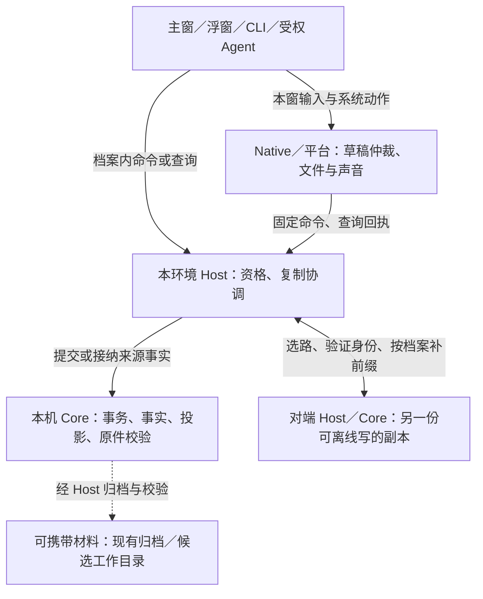

# β27 日用修复与 β28 架构重铸决策草案

2026-11-25 · 前瞻研究与评审底稿。用户已完成本轮批注。当前计划采用 RT 权威与前端投影、以档案为操作对象，以及至少一份外部可接力副本的关机判据。本文保留评审前各选项及产生它们的证据，尤其是下文的双副本手机情景和指定对端查询实验。排期、选型状态与验收以[批注后迭代计划](2026-11-25-beta-iteration-after-user-review.md)为准。[原始批注](2026-11-25-beta-review-user-annotations.md)

## 1. 用什么证据做这个决定

| 方法与原理 | 在本案怎样使用 | 什么会推翻判断 |
|---|---|---|
| [investigation-first](C:/Users/56506/.claude/skills/investigation-first/SKILL.md)，事实先于结论 | 将 272 的问题、ACK 表、拨号读取点和设备观察分别列证 | 设备已能独立读到完整内容而用户找不到入口，应改查呈现 |
| [contradiction-analysis](C:/Users/56506/.claude/skills/contradiction-analysis/SKILL.md)，找能解释多种现象的矛盾并保留反例 | 限定主要矛盾为离线独立写入与联网汇合；另测单机 IME、系统声音 | 离线历史已保全且可解释时，仍失败的分享或声音另有所有者 |
| [overall-planning](C:/Users/56506/.claude/skills/overall-planning/SKILL.md)，给每项取舍设底线和转向信号 | 一方面保持本地提交，另一方面让远端证明可逐步到达。预算看输入延迟和空闲 I/O | 查询事件状态使每条消息反复扫库，应改索引或按需展开 |
| [arc137-dev-standard 通用原则](C:/Users/56506/.claude/skills/arc137-dev-standard/references/通用开发原则.md)，G2/G3/G4/G7/G8/G12 | 权威字段只维护一份。故障归给能处理它的模块。接手者增加一种文件来源只需处理该来源的读取、权限和恢复 | 新增 SAF 来源还要改复制证明或每个消息行，说明边界选错 |
| [arc-ui-design](C:/Users/56506/.claude/skills/arc-ui-design/SKILL.md)，按用户此刻的决定披露依据和动作 | 消息旁答“这台电脑能否接手”；附件处分别提供获取、打开或分享，详见 §5 | 只看默认层就误以为对端已有图片，或点进详情后只能干等 |
| [software-architecture](C:/Users/56506/.claude/skills/software-architecture/SKILL.md)，沿入口、权威源及依赖解释数据流 | §3 只画对本决策有影响的运行边界，分别指定输入、持久化、复制和 OS 动作的负责人 | 出现两个可以独立给同一个动作出具完成回执的模块 |
| [practice-cognition](C:/Users/56506/.claude/skills/practice-cognition/SKILL.md)，用实践结果修改假说 | §6、§7 定义相同初始资料、可控断点、独立读回和失败后的分流 | 即使演示看起来顺利，源/目标事件、原件字节或人机操作有一项对不上，相关承诺就降级 |

这里采用个人规范已裁定的单一变化源、职责隔离、危险时序和副作用归属。本稿将其推导为“每次操作只有一处负责确认”。SQLite、目录布局、Android 文档提供器能力、跨进程锁选型属于具体方案或平台约束。技能中的案例、参数和目录模板各有适用环境。

**调查结论**

- **现状**。前瞻盘点覆盖 `through=179`。路线索引读取水位为 `through=289`，索引所列 feeds 为 170 captures、82 个时间块节点、0 corrections、255 个 timeline 项。最新本地用户记录为 **287**，`453c0a9a-15cf-47fb-9215-14085c9172a7`，仅取“β27修复紧要问题，β28开始在架构上动手重铸”。上述数字以既有读取为据。[基线盘点](C:/Users/56506/temp/report-exomind-beta26-feedback-inventory-20261124-1755.md) · [路线索引与授权](2026-11-25-beta27-beta28-roadmap-feedback-synthesis.md)
- **关键约束**。272 `b2c795ad-5757-470c-b347-04455f741fa3` 证明用户当时无法判断手机消息的远端状态。278 `3cb1dd15-91ec-40bf-9ecc-727169830b29` 是打开一篇公众号文章的正例。281 `a2df3aff-5859-4f1c-b83c-66835fbcc853` 的弹窗归属待定，可先查外心自己发起的动作和脱敏关联句柄，任意进程命令行涉及另一隐私范围。282 `6c262502-6ebb-4b8b-b701-bb96ceef1942` 是大量磁盘读写时系统和 IME 卡顿，进程归因、与 179 的因果联系均待验证。271、273–277、279–280、285–286 不增加产品缺陷。原始记录的相关性和范围见[索引增量](2026-11-25-beta27-beta28-roadmap-feedback-synthesis.md#最新增量只保留有规划价值的记录)。
- **回查源码得到的新区分**。工作树读取时 HEAD 为 `ac682eab`。B1a 已有环境、连接、端点三表，连接管理支持本地开关的 revision 比较更新。受验证的 route 写入和环境拓扑刷新在同一事务里，worker 仍走旧档案级 route。过去的方案 B、已实现的 B1a、未来完整连接督导器 C 是三个不同进度。归档已有带事实、证明、原件及部分完成语义的往返格式。焦点修复的提交、构建、设备范围见 §7。[连接表](../../crates/exomind-beta-host/src/peers/connection_store.rs) · [实际路由读写](../../crates/exomind-beta-host/src/peers/network_management.rs) · [B1a 交付边界](2026-11-22-beta26-b1a-connection-store.md) · [档案往返合同](../development/beta-profile-archives.md)
- **判断**。先查一条消息在指定设备上的证据，再决定是补复制、补查询，还是只改入口。待验证的部分包括无损三端恢复、移动后台生命周期，以及各种共享目录能否承担用户已确认的活动文件夹写入语义。本轮证据为既有现场、源码与只读环境观察，原型及设备实验留在计划阶段。

## 2. 根因假说及阶段取舍

| 根因族／用户要做的决定 | 症状 → 缺少的事实或约束 | 可复用约束、反例与验证 | 次生影响和置信度 |
|---|---|---|---|
| 跨端接手／能否关掉发送端 | 272 的“同步了吗”；140 的清两端恢复。身份、作用域、最后确认的前缀、缺件可同时变化 | 以档案、事件、目标环境查分层证据。已在电脑离线打开原图仍找不到提示，优先查 UI；独立读取缺事件才进复制层 | 错判会诱发重发、重邀、清库，随后消失的现场大幅增加支持成本。对理解缺口高，对协议缺陷低 |
| 档案自主／能否带走并在新设备写入 | 用户希望管理本地目录。运行库、可读导出、可恢复备份、授权身份职责各异 | 规范事实保留身份与来源，一份活动档案有一个提交权威。纯阅读用可读视图即可；重建含证明副本才用往返或规范日志 | 双写会诱发手动合库、历史分叉。可移植需求高，对必须文件为主中低 |
| 编辑意图连续／刚补的一句算哪条 | IME 候选、焦点所在窗口、慢附件、提交中又打字、回执迟到可能属于不同版本 | 宿主管输入，档案内草稿管 revision，命令管固定 ID，原件任务管 readiness。测试同稿改字、已提交后新稿、切 P/Q、取消后晚到。单机输入法失焦不依赖网络 | 排队误发会使人反复回来确认，多个入口各自修时序导致回归。对共享约束高，对同一个实现根因低 |
| 系统交付／文件或提醒能不能用 | 下载完还要分享，系统弹窗出现、通知投递、应用内播放和人听见各有回执边界 | Native 执行有权的宿主动作并报告可观测终点。用 Android 接收 App 读回、Windows 实听。完整原件仍可能没有兼容接收 App | 假完成引发重复点击、重复响和多套平台补丁。阶段差异高，故障点按设备待核 |
| 阅读和定位／我正在看哪一条 | 引用旁路、底栏挤占历史、低频模式难找。对象身份、选择与视图位置容易耦合 | 以 `(P,event)` 定位，选区随对象，视图保留锚点。真实课堂文章成功打开不能作为全部 URL 渲染合同；普通公式正常是保留项 | 人转向截图和人工抄录，多个 renderer 重复维护。决策结构中高 |

**主要矛盾（β28 假说，非对抗性技术关系）**。跨端最终汇合依赖各端保存不同阶段的事实；用户又必须在对端休眠、路线变化、软件关闭时靠本地材料继续工作。在离线阶段，本地合规写入和保全独有内容优先。在恢复阶段，按目标逐项增加可信证据。若这能同时改善 272 的判断、140 的恢复选择和新机恢复，它就是首轮值得抓的矛盾。若原件、父链和证据都齐全而主要损耗仍出在 OS 分享、键盘或声道，就将主攻点移回相应宿主。跨三主题的共同点只到“谁能为这个结果负责”，各主题保留各自的事务与时钟。

| 关系 | 当前侧重与底线 | 失衡信号及对其他关系的影响 |
|---|---|---|
| 短期修复 ↔ 长期重铸 | β27 明显偏向可单独验收的日用功能；β28 用一次贯通实验固定接口 | 分享必须等全新存储引擎才交付，说明架构阻塞日用。反过来，每个页面自行记“完成”会制造重铸成本 |
| 跨端统一 ↔ 实例自主 | 统一档案/事件身份、证明语义，每个副本自主保存并管自己的字节和权限 | 中转端一停，本地无法新建记录；或一端清理使另一端静默删件 |
| 最终一致 ↔ 即时可理解 | 优先即时给出本机回执和目标已知状态，允许诚实的“尚未确认” | 把旧 ACK 当在线状态会误导关机；为消灭未知而全网轮询会损害电量 |
| 人/Agent 管理 ↔ 高效读写 | 移植从可验证交换开始，热查询先用现有 SQLite；工作目录直接写权单独裁决 | 双向 watcher 反复导入同一结果，或索引重建时输入明显变慢，暂停扩展介质 |
| 默认安静 ↔ 全状态显影 | 正常记录旁只呈现改变当下决定的信息，故障就近给出口，详情保留依据 | 每行长期贴多设备日志，或缺原件只有到系统打开失败才知道，都需调整 |

## 3. 运行模型与同步决策

实线表示已有职责方向；主窗、CLI 和 Agent 各走自己的授权入口，平台专属控件只由合法宿主调用。虚线右端包含两个阶段，归档可往返已有源码，活动目录是待证方案。脱敏诊断和状态查询是读侧，不能顺带建成员或触发网络全扫。[Native 工作区](../development/beta-native-workspace.md) · [Agent 授权](../development/beta-agent-grants.md)

### T3 类比可借到哪里

- **本轮可观察**。`t3_environment_links` 在本环境列出两个可达的已链接环境，其中一个标为 Termux，各有环境 ID 和访问范围。这个观察说明可以按目标环境寻址。手机漫游、网络实际走向和进程被杀后的行为仍需分别演练。用户描述的自然接续是产品体验证据。
- **可复核机制**。T3 固定源码 `e313a122` 的连接运行合同明确由每个客户端的每环境 supervisor 负责传输重试，平台供应网络与前后台信号。建立 socket 后要等首个配置快照，线程数据另有快照、序号和恢复边界。连接中断保留登记，重新连上不自动重放用户变更。另有当前会话的 `reachable` 观察，运行包对应提交未知。[T3 固定版本运行合同](https://github.com/pingdotgg/t3code/blob/e313a122452835da330feef41d0b74a4d2eddbeb/docs/internals/connection-runtime.md) · [本地参考调查及源码入口](../research/2026-11-19-easytier-t3-connections-and-sync.md)
- **迁移结论**。采用“环境稳定、路线可变、重试有人负责、连通与数据新鲜度分别表达”。T3 客户端可以投影同一服务端线程；外心的手机与电脑可以分别离线产生新事实，所以 T3 的服务端快照替换客户端缓存若直接照用，会覆盖一端独有历史。provider、project、thread、MCP OAuth、远程委派属于 T3 自身领域。交互相近不能推断外心应使用同样拓扑、协议或超时常量。

| 对象 | 身份、权威与现有能力 | 缺口／恢复责任 |
|---|---|---|
| 环境、实例与设备 | 方案 B 用稳定 `device_id` 标识安装环境，绑定已验证密钥/pin。`runtime_id` 只标当前运行代次。用户在手机上查看桌面，和手机自身作为本地写入环境，是两个作用域 | 换网络只换路；换进程重新查证；换密钥或重装身份要重新核验。设备名和 IP 只供识别。首次选择显示“我在手机档案写入／查看目标电脑” |
| Connection、endpoint、route、channel | Host v7 保存本地稳定 connection ID、有序端点、revision、本端启停、可空的远端观察及其时间。endpoint 是候选地址，route 是拨号路径，一次握手只生成短期 channel | `peer_routes()` 仍读旧 `(P,device)` routes。不能仅改 UI 开关就承诺 worker 改走新路。先做观察模式对照实际拨号，后续才在单一 Host 入口切换选路；关闭和未知单独验 |
| 档案及成员 | Core 管 `profile_id` 下的内容，Host 管 `(P,device)` 的成员资格、能力、撤销及 generation。读写 Agent 的 scoped grant 是另一个授权体系 | 已发现/已连不赋权。同名不同 ID 并列解释；同 ID 再加入按已有状态核对；用户停用路线、离开档案、撤销成员分别执行 |
| 事件与来源链 | Core 有 event ID、digest、origin device/epoch/seq、证明与本机接收序号。中转成员能提供已持有第三来源的有证历史。Host 存目标对该来源的前缀 ACK | 显示指定事件前需查到它的原始位置和已核验前缀。不同设备 `local_seq` 不可比较。缺键、缺证明或权限变动时保留未知。接收端处理重复页须幂等 |
| 时间块、原件和文件可用性 | Core 以块节点/父链解释状态，Host 交换可解释性和缺件信息；原件按引用、生命周期许可、实际长度/hash 验。Native 与系统负责文件交付 | 聚合报告只适用于其冻结范围。指定块缺父节点就补链，指定图片缺字节就取件。已校验仍可能遇到 SAF 权限失效、无接收 App 或播放失败，由宿主负责接管 |

源码入口分别见[拓扑与旧 route 同事务](../../crates/exomind-beta-host/src/peers/network_management.rs)、[实际 worker](../../crates/exomind-beta-host/src/peers/network.rs)、[目标 ACK 表](../../crates/exomind-beta-host/src/peers/sync_store.rs)、[多来源会话](../../crates/exomind-beta-host/src/peers/multi_sync.rs)及[复制合同](../development/beta-multiorigin-sync.md)。

**272 的按设备查证样例（详情层）。** 用户批注 A13 将默认层定为“这份内容已到至少一个能接力的外部 RT”。以下展示点进详情后如何解释具体接收端。手机按下发送，先显示“已保存在手机”。用户关心的目标若是电脑，消息旁可显示“电脑已确认这条记录”或“电脑尚未确认”；展开给出所指设备与证据范围。计算条件是同 P、同目标、同 origin/epoch，确认的链前缀实际覆盖该事件的位置与内容，且查询者可读。已有 ACK 表保存序号和 hash，该表没有 ACK 时间列；需要时间时注明本机读证据的时间，准确的对端确认时间必须有独立来源。旧回执只支持“曾确认到此”，恢复代次变化后当前持有状态要重新查证。接力时 PC 只收到 Termux 的 ACK，只能报告 Termux。要说手机已持有，需手机自身可归属的证明。一个“其它设备”计数必须固定目标集合并去重，缺分母就只列已知目标。

**状态不是一条万能进度条。** 发现候选 → 路径可达 → 身份核验 → 成员接受，是首次联网的四个问题。随后并行问“指定事件进入哪一端的事实链”“块能否解释”“这件原件在目标端是否有合格字节”“此宿主是否成功打开/提供给接收应用”。本机离线写入无需先过发现。进度页可以说“电脑已确认正文；图片待获取”，并给“在电脑获取图片”或“查看持有端”。若只有聚合 `missing_originals`，指定图片应标“未单独查证”。

**谁负责重连。** 候选边界是每个实际 Host 有一个协调入口，复用现有 peer worker。按本机环境和目标折叠唤醒，按 P、成员代次、来源与传输任务分别调度和验权。用户批注 A09 明确采用 RT → 界面。连接 Termux RT 的 Android 前端在 RT 离线时显示最后确认点，RT 重启后恢复在线。独立安装的其他 RT 以各自的身份、签名和存储参与档案复制。应用返回前台、换网、用户重试只发信号；Host 检查最近可用路线，失败才有界尝试已启用候选，尊重明确停用和撤销。每次结果绑定 `(P,peer,成员代次,runtime,attempt)`，旧成功在原尝试下对账，禁止覆盖当前选择。OS 挂起时显示最后确认，恢复时沿已提交游标补页。诊断只含阶段、错误码、时间及脱敏关联号。持续优选、自动回切和高级退避参数等 B 的故障矩阵和空闲耗电基线出来再决定。[方案 B 与长期 C](2026-11-19-v0.6-industrial-iteration-roadmap.md#长期选项-c完整连接督导器)

## 4. 本地优先档案怎样划定写入权

**推荐迁移顺序**。先以现有 Core/SQLite 为活动档案的唯一提交权威，`.exomind-profile` 负责有边界的离线恢复，Markdown/manifest 负责查阅。给人和 Agent 提供可读文件与可验证的更正提交路径。用户在 A01 确认保守接纳和正式文件夹两种模式并存。隔离实验用于确定哪些具体介质能够承担文件正式发布、来源验证和派生索引重建。每个档案实例的 manifest 明确其模式、版本与提交者。双向监看两份可写主数据，会让“最后是谁改的”变成无法回答的问题。[两类导出及中断语义](../development/beta-user-exports.md) · [导入接纳](../../crates/exomind-core/src/replication/profile_archive.rs)

| 内容 | 必须保留／允许人和 Agent 做什么 | 存储与失败语义 |
|---|---|---|
| 事件、修正与时间块 | 稳定 ID、来源、原始内容和 digest；时间块另有节点因果关系。人能读原文与有效视图，Agent 按允许角色追加或提出更正 | 事实与来源位置/证明按事务接纳。缺父链保留事实，投影标部分可解释。导入旧块只还原历史，运行中的本机 deadline 需另查 |
| 附件/原件 | 可读 manifest 与文件名关联到原件 ID、长度、hash、可得性；实际字节可独立携带 | 流式暂存、校验、发布，重试按同一身份。丢库不能用空文件填缺口。尊重目标端已释放状态，正文先恢复 |
| 索引/投影 | 搜索、列表、标签、更正后的阅读视图、时间块计算结果用于快速查询 | 可重建数据记录算法/schema 版本与已应用的规范头。在旁路重建再切换；重建时旧视图标其新鲜度。读库损坏与源事实损坏分报 |
| 复制证据与本机私有状态 | 可携带可验证的规范来源及公开证明；成员、私钥、Agent grant、路由、发件命令回执、本机任务/草稿另管 | 新电脑继承内容身份，获得自己的设备身份。重新授权后查询/写入，重新协商 ACK。恢复包中事实、证明、字节、目标可接纳度各有完整性；部分接纳后允许继续对账 |

| 权威模型 | 离开软件后能做什么 | 重建、并发与成本 | 本次建议 |
|---|---|---|---|
| A · 活动事务库 + 版本化交换材料 | 用普通工具读结构化导出，Git 管有意导出的文本。用完整往返包恢复另一个副本；外部改动进入提案/导入入口 | 单宿主写事务，查询快，沿用现有来源验证。若唯一 DB 损坏，只能从可用、已校验的备份或有权副本恢复到其覆盖点。范围导出的 Markdown 无法重建完整来源链 | 作为迁移基线。先量清生成可读材料的延迟和备份新鲜度 |
| B · 可移植规范文件日志 + SQLite 派生索引 | 停应用也能审阅 manifest、规范操作、图片与冲突。普通编辑器可写工作副本，Agent 可离线生成变更提案 | 单写入者提交版本化清单与不可变段，读者按已发布代次读取。必须验证落盘顺序、进程死亡、分支和 schema。索引删除后从已验证的 manifest、事实、证明和 blob 重建；缺段或 hash 冲突时提示最近完整代次。大量小文件、Git 二进制、SAF 非原子改名和扫描都值得实测 | 用户已选定正式文件夹模式。用独立副本与 A 对照恢复结果及代价，确定能支持正式发布的介质 |
| C · 人可编辑工作目录 + 显式提交到 A | 外部编辑日记/批注，可在无外心时准备一批修改。Agent 可读写工作材料，提交时得到逐条接纳/冲突结果 | 工作文件有 base event/digest 与格式版本。重新打开先预览差异，校验角色和来源后追加更正并返回回执。投影文件重生成要避开未提交编辑；草案分支可独立保存。多一层提交流程，换来清楚的作者与恢复点 | 若需求是“离开应用整理，回来能安全接纳”，优先验证 C 作为 A 上的薄入口 |

**介质是能力，不是事实格式。** 内存 mock 已能提供 `BetaClient`、intent journal、文件源及可选能力，适合失败顺序可重复的演练。页面刷新后的持久承诺为零。浏览器候选可用 IndexedDB 事务、可用时另存大对象，并处理配额、逐出、隐私模式与多标签并发；先用真实浏览器证明一个事件加一件原件的重开恢复。应用私有目录适合活动 DB/事务、文件锁与高频查询。共享桌面目录需验证多进程互斥、崩溃后的唯一写者、外部复制时的一致快照。Android 共享目录经 SAF 获取授权 URI，权限可撤销，文档提供器的随机访问、锁、原子发布、持久 URI 都须按实际能力验证。能力不足时采用私有事务库加显式往返；外部目录保留可查阅产物和待导入修改。[内存来源](../../src/beta/dev-mock-profile.ts) · [Termux 存储边界](../development/termux-environment.md)

**依赖倒置的最小范围（候选）**。领域层定义“读规范快照/按来源接纳一页/提交固定命令查回执/按许可取原件”所需语义；Core 现有事务负责实现，Host 验权，Native 负责路径/URI 与系统交付。先在有真实第二种来源的“读取和预检”上共用合同。内存实现声明易失，查询源只承诺查询，不把 mock 提升为具备签名复制的生产引擎。外部工具写入时区分角色，observer 只能查阅，Agent Note 或外部回顾只能执行相应角色动作，人类更正走人类确认或明确的新协议。普通文件权限不产生作者签名、membership 或应用 grant。未运行 Host 时可生成待审核输入，恢复时才赋予合法提交身份。

**提交与冲突规则**。同 ID 同规范内容的重复导入按幂等处理，同 ID 异内容保留冲突及两份材料。不同 ID 的离线新增能合并，来源缺口等待证明。更正携带目标 ID/原 digest/作者，保留旧事实；对同一底稿并发改写可先展示两版并由人产生裁决记录，自动合并需按字段另证。删除要分别指归档隐藏、追加逻辑撤回、本机释放字节、不可恢复清理；明确各自影响范围。撤销使后续操作重验权，已读取的他端副本无法靠撤销远程收回。重复、乱序和进程中断都按同一 ID 查证，将部分成功留给续接。所谓“不可篡改”可限定于**已接纳来源事实的身份和历史证据**，阅读结论可以更正，未提交工作文件可以改。用户已确认术语为 **CRDT**，首要场景为外部修改。时间块暂停/恢复、撤销与二进制文件分别核验其领域规则。仅有事件集合并集无法决定所有用户可见冲突。

**迁移及撤回实验**。从已校验的副本导出固定切点，保留旧库和独有内容。在新位置组装与验证，逐项比较 event ID/digest、来源前缀、块投影、附件 hash 和缺件清单。新 schema 先由只读 reader 识别，未知版本停止写。切换时旧写者退出、确认新写者取得独占资格，迁移期间新增的尾部另作交接。失败时继续使用可确认的旧权威，保留已提交的新尾部供显式合并。若共享介质无法可靠发布一次提交，限制为读/交换用途。分别记录恢复耗时、索引重建进度、输入延迟、磁盘写量及空闲耗电，先建立每台设备自己的基线。

## 5. 以用户任务审查 UI

| 页面/操作族 | 取舍与信息负责人 | 动作 → 反馈／失败 → 可证伪验收 |
|---|---|---|
| 第一次进入、档案切换与备份 | 保留档案 UUID 和归档预览。把本地位置、是否持久、创建/打开/加入重排到选择现场。Native 知道位置权限，Host 知道成员 | **P09、P14、P21**：点开同名档的预览可分辨来源，取消后档案/成员数相同；创建和加入各有明确提交点。同一项重按、A→B→A 回到原档案及相应草稿，权限失效给重新选址 |
| 日志、搜索、引用、批选 | 保留列表与原事件 ID。重设计模式入口，把引用来源和证据放回该对象；正文链接/复制各有独立目标 | **P01、P02、P03、P16、P17、P20**：缩略图帮助认图、设备标记附文字/可访问名；小屏打开键盘仍看到上一条和主动作。经焦点/触摸展开详情，直接跳引用，再返回原锚点。筛掉已选项显示仍选数量。若须从菜单手输 ID、键盘态关键动作消失或每行重复同一身份，失败 |
| 输入、预发送、附件准备 | 保留已交付的焦点改善。把待发的对象和恢复动作合到草稿旁，窗口只拥有其输入/选区；应用/草稿 journal 持有版本，Host/Core 持回执 | **P04、P07、P08、P10、P12**：组合输入选词时零次提交，软键盘与触摸都有无修饰键的送出入口。进度更新不挪焦点/顶走输入。改字可解除尚可取消的预发送，已提交时新字进入新稿。切档后旧 ACK 回原档，未知可查同一命令；中断试验后逐端核对消息数和内容 |
| 同步、设备与邀请详情 | 重设计总览与事件就近状态，复用 Host 数据。环境选择和换路线是两种控件。默认设备卡上显示当前作用域，需要诊断时才展开端点结果 | **P05、P06、P11、P13、P15**：在记录旁看到目标和最后确认范围→点该设备看缺哪项→换可用路或取指定原件。网络关闭、超时、拒绝各有解释，远端开关未知保持未知。切换目标并注入旧成功，当前目标不变。只靠红绿或无限转圈均失败 |
| 附件预览、系统分享、文件打开 | 重排为对象就近操作。保留系统 Sharesheet 的授权和无障碍职责。预览收起后恢复原图和位置。只有工作表面被面板遮挡时使用就地收放 | **P18、P19、P20、P14**：在图片上点分享，先查本机字节，有件才申请临时只读授权；未就绪给获取/返回。收起面板不丢选图，选择器取消后无对外成功声明。窄屏和读屏可操作，原生系统警示仍可辨。P19 的画布方法限于这种持续预览表面 |
| 专注页、浮窗、到期声音与提醒 | 保留主窗/浮窗是同一业务的不同客户端。重设计重试入口的结果呈现。块状态归 Core，应用内发声归 Native 播放通道，系统通知单列 | **P04、P05、P06、P08、P12**：结束时给对应块的到期时间和播放尝试；无设备/静音/入口未就绪可查看和重试。隐藏主窗后仍能在浮窗暂停，旧节点重放不重复响。Windows 实听、Android 锁屏交付和视觉效果各自验证 |

**评审怎样执行。** 项目 UI 规范中的 token、共用控件和特殊宿主表面可保留。C01 按现有语义复用控件，C02 的布局/配色/材质分开验证；本案没有预设编辑事务或已批准视觉 Demo，C03/C04 只在相应场景出现时启用。C05 要求看实际宿主。I16 的恢复出口、I17 的相邻结果、I18 的安全预检、I19 的连接作用域和 I20 的专用模式，分别用 R28 更正失败、R29 提醒重试、R26 切网期间编辑与 R27 导出模式往返验证。SF06/SF07 用于查看最后证据和部分成功。设计师请新人不看说明完成一次任务并说出“哪台有文字，哪台有图，下一步按哪儿”；记录误判点。另测焦点、辅助技术、峰值输入延迟、声音与主观手感，人审按体验单独接受。[UI 规范](../development/ui-spec.md) · [交互模式](C:/Users/56506/.claude/skills/arc-ui-design/references/interaction-patterns.md) · [宿主规则](C:/Users/56506/.claude/skills/arc-ui-design/references/host-and-validation.md) · [情境回归](C:/Users/56506/.claude/skills/arc-ui-design/references/regression-cases.md) · [反馈验收门](C:/Users/56506/.claude/skills/arc-ui-design/references/feedback-acceptance.md)

**焦点与预发送共享什么。** 焦点有两类合法结果，一是用户正在连续写入，二是用户已经主动转到别的控件。仅当前窗口/IME 知道该保哪个结果。附件晚到时，判断可否发送需要当时的档案、草稿版本、材料与用户意图；DOM focus 提供不了这些证据。工作区已有 CAS、固定命令和未知回执恢复；活动 composer 里另有预发送状态与附件 readiness，须追它和 journal 之间的在途所有权。建议先复用“结果只结算到发起对象及版本”这条约束，不合并为一个全局 UI 状态机。可用两个反例验收：移动焦点时已提交事件仍应存在；保持焦点时被改过的旧稿仍不能被旧附件回调发出。以后添加触摸或 CLI 入口，只需兑现各自输入边界和领域提交合同。[焦点与预发送调用点](../../src/beta/BetaApp.tsx) · [草稿与失败恢复](../development/beta-native-workspace.md#命令草稿与失败)

## 6. 用五段连续经历验证提案

以下为评审时提出的对照情景。故事二的手机本地写入以手机实际运行独立 RT 为前提；仅连接 Termux 的前端遵循 A09 的离线／上线约定。实施时采用[批注后计划的三 RT 接力场景](2026-11-25-beta-iteration-after-user-review.md#rt-身份link-与事件接力)。

**故事一｜第一次打开，就知道照片存在哪。** 第一次用外心的人在桌面创建“课程笔记”，写下第一句并附课堂白板照片。旧式失败路径是同屏出现“档案、来源、备份、邀请”，用户为了开始记录随便点一个，后来记不起照片究竟进了哪个位置。目标是先选“保存在这台电脑”，看见可再次找到的位置和是否持久；打开同名档预览时能取消，原稿还在。写完时正文和图片各有自己的本机结果。设计师让对方关闭应用后找回材料，并用只读工具辨认原文与附件。A 模式靠导出读，C 模式能准备待提交修改，B 模式须从公开规范头找到同一事实。路径权限丢失时重新选址；“回到原档”不得创建同名空档。这样一次选择形成可迁移的操作习惯，维护者也只需在介质入口处理权限差异。验 P09/P14/P21。

**故事二｜电脑合盖之前，手机还差哪一件。** 手机从办公室 Wi-Fi 换移动网，电脑已存一条带图记录，获该 P 成员资格的 Termux 副本此前收到正文，图片仍在桌面。若一个绿勾就叫“同步完成”，用户合盖后才发现手机上只有图框。目标是手机可先记录；网络变化只唤醒本机协调者，有可用已授权路线时沿来源前缀向 Termux 续读。手机看到“已收到文字；图片待从桌面获取”，可继续工作或等桌面上线。若 Termux 同时持有合格原件，也可选择该来源。让手机与 Termux 分属独立环境，再让 Android 挂起、唤醒、旧网络结果迟到。终点是手机实际打开 hash 相符的图；在缺件情况下，能指认谁最后确认拥有什么。对比用户从反复配对变成只取缺件，开发者从每页重连变成按环境处理唤醒。后台一直存活仍是设备测试条件。验 P05/P11/P13/P15。现场问题是 272 `b2c795ad-5757-470c-b347-04455f741fa3`。

**故事三｜一件慢附件，两条不同的记录。** 手指点发送时，第一条的图片还在准备；用户继续用中文输入法给同一稿补字，又切到列表读上一条。失败时会同时发生两种错觉：焦点回来像是成功了，旧附件就绪却可能发送已经过时的文字。目标是能在草稿旁看清“准备好后发送”，继续编辑同稿会明确取消旧预发送并保留图片。若第一条已越过提交点，新文字属于下一稿。故意让附件回调和两次输入倒序，丢一次本机回执，随后查同一命令。新人最后能读出两条各自内容；设计师再用实体键盘、IME 选词及编辑中切档分别验证。人不必守进度条，后续增加分享收件入口也复用版本规则。输入法是否合手留给真机。验 P04/P07/P08/P12。基线中连续输入、焦点使用的正反证为 156 `5eee887f-a80d-4a32-9404-bd785d4c76ac`、157 `d70153b9-42a3-4dec-92c8-365044828c99`。

**故事四｜一台新电脑，恢复三端各写的一句话。** 断网一天，桌面、手机、Termux 各自给同一档案新增一条；两端还针对同一旧句给出相反更正。先补到其中一端，再只带它的本地材料去新电脑。历史 140 `92bc82a7-14a8-4ccd-8dc0-b9d34aefc7ab` 的恢复依赖清两端，这次每端都放有不可牺牲的独有内容。A 用往返包逐项核冻结范围与字节，C 额外保留未提交编辑，B 移走派生索引后从规范清单重建。缺任一来源，先如实列缺口，后续用第二份材料补齐；谁也不能替新电脑继承原私钥。恢复后新人读到三句、看到两条更正的来历和待裁冲突，原图可离线打开，再授予 Agent 本档案合适角色，查询、提交一条有权说明，重复同一命令只有一个结果。一次演练同时检验人在无软件时的可管理程度、是否会被迫指定唯一旧设备，以及换存储时能否复用同一接纳语义。验 P06/P13/P14/P20。

**故事五｜手机把图片交给另一 App，电脑在课间响一次。** 手机上选中刚才的白板图，用户想直接发到目标 App。下载进度结束却只给“导出”，会迫使人先找文件管理器；若取消系统选择器后写成“分享成功”，用户还会误以为对方收到了。目标是原图旁直接打开系统分享，缺件可先取，授权范围限这一份合格字节；取消回原消息、收到方能读到的测试件逐字节核验。此时 Windows 上运行的课程块到期，用户要听见 α 方向的应用内结束声。用没有系统通知声的情形验证一次，再重开面板验证不会重响历史。第一步由 Android Sharesheet 和受控接收 App 裁决，第二步检查 Windows 播放与人耳听见，静音是独立对照。减少找文件与盯屏时间，两端功能分别维护，无需一个涵盖声音和分享的抽象“已交付”。验 P03/P08/P12/P18。优先意见来自 item 45701；平板下载而发送端缺反馈为 167 `e49bb24a-5669-47e6-86b2-17dbc5cc2406`。[优先意见来源](2026-11-25-beta27-beta28-roadmap-feedback-synthesis.md#用户意见与-agent-建议的归属)

## 7. 路线、原型和验收阶梯

| 阶段／归属 | 推荐处理及完成边界 |
|---|---|
| β27 已交付的焦点首项 | 授权 item 46047。功能 `f0ab0fbf`、构建请求 `7cfa90f` 已提交推送，run `45537104031` 四平台成功。Windows EXE 的 build-info、来源与 SHA-256 已核验并交付，item 46378。mock/browser 与自动化覆盖焦点首项。剩余实体键盘、软键盘与 IME 放到设备验证层。[授权与交付](2026-11-25-beta27-beta28-roadmap-feedback-synthesis.md) · [构建记录](https://github.com/exomind-team/exomind/actions/runs/45537104031) |
| β27 当时明确的优先事项（后续启动见批注后计划） | item 45701 确定移动端事件附件直达系统分享最高优先，预发送逻辑也优先；Windows 运行时结束声是刚需，方向为借用 α 播放能力。各自最小独立终点是受控目标 App 可读实际字节、一次变更意图至多产生一次合意提交、Windows 指定块到期实听一次。常规公式目前正常，极端公式次优先。item 45710 是 Agent 综合排序。[调查与验收计划](2026-11-24-beta27-feedback-investigation.md) |
| β27 仅调查线索 | 272 进入 β28 状态语义，先查一个事件的证明能否取得。281 先定位外心可控入口；282/179 通过同一时间窗的外心进程读写量、UI/IME 输入延迟和关闭相关工作负载的对照归因。278 仅作该文章路径正例 |
| Agent 建议 | 旧报告提出全局误退出和无损三端恢复值得优先关注。快退适合局部作用域实验，恢复演练适合 β28 原型；本稿选择的次序是讨论建议。β27 其他相关未提交原型仍须逐项裁定 |

**β28 第一个共享不变量**。对同一档案中的具体事件，换 route、换进程或换可读介质后，仍能查到同一来源、同一内容。每一条“目标已取得”的陈述必须指出目标及覆盖的层；尚在其他端的独有记录保有继续汇合的路径。

1. **先做读侧实验**。隔离的 A/B Host 用既有 Core 写一条带图事件和一个有父节点的时间块。B 收正文，故意留图未到。按 `(P,event,目标)` 用既有 origin 证据推导一次读数，与 B 独立精确读回对照；再让 B 核验字节，观察文件交付需另走宿主。首个产物是来源可查的三项结果及短文案。若现有证据够，止于查询与呈现。若只知道整批统计，保留未知并定位最小缺字段；如果无法绑定事件和已验证前缀就不发布逐条肯定文案。
2. **再测恢复和单一协调者**。加入 C，每台保留一个独有事件，切断一条路、手动禁用另一条、重启中转、延迟旧 ACK、撤销一次成员资格。验证三端冻结集合及来源，空闲时测重连次数，显式停用始终生效。先影子比对新连接表与旧拨号路由，随后如需切换用可撤回的单一读入口，所有原件任务走相同资格约束。双 owner、越权、覆盖独有历史、无法解释的回执变绿均停止扩展。高阶督导器需真实多路与能源数据决定。
3. **再测可携带与编辑**。同一份资料走 A 的往返、C 的外部更正预览，再小范围试 B 在丢失索引后的重建。比较规范事实/签名/图片、冲突与显式缺件、峰值写放大和离线可读性。缺件被称为完整、并行写者丢事实、迁移回退重发命令、文件权限丢失后伪报已存，均退回前一层可验证承诺。若 A+C 已满足用户任务且 B 的代价显著，工作目录引擎到此暂缓。
4. **再扩宿主与界面**。先交付真实手机分享、Windows 声音、Termux 接力各自的可复测证据，再把成熟的状态与入口扩到同族页面。下一轮根据首个失败层选择 Core、Host、Native 或 UI 的所有者。一次跨端故事能复用现有巡检 evidence 关联，`event_id` 去重与 reviewed/reported 台账沿用既有机制。[工业化分期](2026-11-19-v0.6-industrial-iteration-roadmap.md#分期任务与成功判据)

| 验收阶梯 | 能证明什么 | 待下一层裁决／进入条件 |
|---|---|---|
| 源码、单测、mock/browser | 给定事件、乱序、IME 合成事件和权限输入下，所有者、幂等与呈现的合同 | 用故障样本看到预期失败和修正后结果；视觉手感、真实打包接线待测 |
| 精确构建候选 | 源 SHA、recipe、build-info、版本、平台包 hash 可关联。目标程序可通过正常入口执行 | 每个目标先核实产物身份和能力，不能用另一个安装包代替；构建绿只给出制品证据 |
| 隔离跨端／故障 | 停网、迟到、重启、重复导入、换包与缺件时，核三份独有事实、因果链、原图 hash 与无额外授权。确定首个失败层 | 注入真实进程边界、读接收端、保存覆盖范围；模拟器的权限与能源行为留待设备 |
| Windows、Android、Termux 实体 | Windows 物理键盘、运行时声道与实听；Android 软键盘/IME、系统选择器、受控接收 App 与真实内容 URI；Termux 单独身份/沙箱、锁屏、唤醒、切网、被回收后查证 | 同版、设备/网络/材料记录可复测。确认后台中断后本机可继续，恢复后补齐。设备不可用则对应格保留待测 |
| 第一次使用者与设计师 | 新人说清目标和已确认层，能完成缺件恢复、分享取消、返回选区；设计师审核噪音、手感、无障碍与任务耗时 | 正确性、可理解性、审美和资源成本分别记录。达到已约定的任务条件后才扩大到同族页面 |

**长期战略按人的能力排。** 可记录要求离线也有可查的本机回执；可接力要求不同环境继续看同一对象和独有记录；可恢复要求只拿合格材料在新机读回，并能诚实报告缺口；可审计要求把任一次动作追到来源、授权边界和恢复结果。与产品“让任务、时间、事件、承诺、反馈持续推进”的愿景相连。每一阶段先取得失败样本与所有者合同，再考虑自动选测或意图编排。人负责优先级、接受与发布。[产品愿景](../product/vision.md) · [架构原则](../architecture/principles.md) · [工业化路线](2026-11-19-v0.6-industrial-iteration-roadmap.md)

## 8. 评审分叉的裁决去向

用户已批复档案写入的两种模式、CRDT 的首要适用范围、Termux RT 与前端的关系、以及移动端分享的交付终点。实施范围、遗留实验与开发线程 item 46835 的 β27 启动授权统一查[当前迭代计划](2026-11-25-beta-iteration-after-user-review.md)。原话见[批注原件](2026-11-25-beta-review-user-annotations.md)。

## 9. Agent 授权与外心访问的连续性

**建议把首次授权的交付终点定在一次冷启动读回。** 用户在受信任主机选择档案、Agent、角色和用途。关闭签发面板，再从相同 OS 账户启动一个无聊天历史的 CLI 进程。它仅凭任务登记的授权引用，能够找到本机正确实例、读回测试记录，并说清本轮覆盖到哪里，首次接入才算就绪。定时任务与普通会话走同一入口。用户明确将其列为高优先的集成议题。本轮批注将等待与通知策略归给值守 Skill，β27 软件迭代由开发线程凭 item 46835 的启动授权接手。

### 9.1 现场与源码给出的边界

这条需求来自 T3 用户消息 `9f3e6382-b438-4107-b200-ce87ae378f37`、`a4c4c24e-7b45-41cd-bdff-8222782a6db7`、`58c45e52-1253-4397-9aa6-42c46def92df`。用户已经交付 handoff，新运行仍向用户索取同一材料。此前本线程在用户给出新端口后，使用原授权从新 runtime 读完 `through=179`，证明该次换端口可继续访问。无人值守地取得正确授权并找到实例，是另一个待验收条件。[路线索引原始反馈与体验合同](2026-11-25-beta27-beta28-roadmap-feedback-synthesis.md#agent-自动化集成handoff-持久授权与明确访问结果) · [先前读取证据](C:/Users/56506/temp/report-exomind-beta26-feedback-inventory-20261124-1755.md)

| 已有能力 | 直接影响决策的缺口 |
|---|---|
| Host 保存 grant 身份、token hash 和撤销状态。Native 暂存一次性交付材料，应用停止后清除。已认证业务请求还会核查授权。 | 需要在首次交付时由客户端完成可持久、安全的接收。Host 的 hash 无法恢复客户端丢失的秘密。冷启动失败应提示凭据库、目标登记或服务端授权中的具体一层。[授权合同](../development/beta-agent-grants.md) · [Host 认证](../../crates/exomind-beta-host/src/lib.rs) |
| 安装的 Windows CLI 已能按 `exomind.exe` 持有的 loopback listener 找候选并做 `hello`，随后只对选中 handoff 的 profile 请求 `access/check`。 | 默认 `findHandoffPath` 也纳入 QA 目录和历史附件，以显示名匹配和修改时间选文件。动态路径对多个候选分别做带凭据检查，最后才判断歧义。任务需要在发出凭据**之前**确定唯一受信任接收方，同时用登记的档案 UUID 精确选凭据。[CLI 的选择与连接逻辑](C:/Users/56506/.claude/skills/exomind-monitor/scripts/cli.mjs) · [Windows 发现脚本](C:/Users/56506/.claude/skills/exomind-monitor/scripts/discover-local-beta.ps1) |
| 公共 CLI 可以识别全部候选明确 401/403 的情况。adapter 已能固定 Note 命令，核对本机回执、事件及作者。 | 没进程或能力不匹配等动态分支可能持续等待。巡检包装脚本还会在拒绝后继续循环。两种入口应共用有时限的访问结果。Host 的 `AgentAccess` 含 P、角色、Agent、runtime/device、`allowed`，当前缺少服务端 `grant_id` 和撤销原因。CLI 输出的 grant ID 来自本地 handoff，精确 ID 对照应注明证据来源。[巡检循环](C:/Users/56506/.claude/skills/exomind-dev-patrol/scripts/connect-until-readable.mjs) · [AgentAccess 字段](../../crates/exomind-beta-host/src/agent_access.rs) · [Note 回读](C:/Users/56506/.claude/skills/exomind-monitor/scripts/beta-monitor-adapter.mjs) |

### 9.2 首次登记、密钥和责任所有者

| 谁负责 | 跨运行保留什么 | 哪类变化怎样处理 |
|---|---|---|
| 用户与 Native 签发端 | 一次明确选定受信任主机及本地账户、外心授权签发实例的稳定身份、`profile_id`、`grant_id`、角色、适用时的 `agent_id`、许可用途及能力上限。普通 observer 的 Agent ID 可以为空。 | 档案改名只更新标签。端口、PID、runtime 和构建号属于运行信息。同一签发身份、同一 P、协议与所需操作语义兼容时自动复用。新 P、新主体、新主机或扩大权限需显式授权。签发身份变更只有原信任链可验证的迁移才可续接，否则交由人重新配对 |
| Skill/CLI 的本机凭据存储 | 为每种登记提供稳定且非秘密的本机引用。任务配置持该引用和所需操作，普通调用按显式别名或先前为该用途登记的唯一默认值解析。grant 元数据与密钥引用分开，secret 由受支持的系统凭据库保护。 | Windows 首选当前账户的 Credential Manager 或 DPAPI 配合仅该身份可访问的 ACL。跨平台采用等价用户密钥库。密钥库锁定、任务以另一账户运行、存储损坏分别报告。权限保护失败时终止登记或访问，保留原有效登记。固定别名冲突交回授权设置选择，时间戳和同名档案没有选择权 |
| 本机任务与调度器 | 保存授权引用、任务获准的动作、作用域化游标及在途命令引用。有效操作取**任务许可、登记上限、Host 当前能力**的交集。普通会话和新调度进程均从同一用户存储解析 | 只读巡检即使绑定可写 grant 也仅执行读取。计划任务以首次授权的 OS 身份运行。并发运行以原任务的业务幂等键及持久 journal 仲裁，共享凭据本身不赋予重复发表权限 |
| Host 与 Native 授权管理 | Host 裁决有效授权，每次请求、分块和最终提交按生命周期重验。Native 提供用户可见的撤销、更新与安全交付 | 本机“忘记”只删除客户端材料。服务端撤销负责拒绝未来业务及尚未取得提交资格的写入。轮换由签发方显式发起，客户端验证同用途的新绑定后原子切换引用，明确何时撤销旧 grant。旧在途写保留原身份，无法查证则保留未知 |

**存储与迁移。** 首次安全交付直接进入本机凭据库，将完整性受保护的元数据与密钥引用一起原子登记。登记中断允许重开签发界面查证本次结果。私有目录置于项目、Skill 安装目录和普通同步目录之外，目录 ACL 限制读取与替换，秘密只在发起认证的进程内短时解封。Git 忽略条目和测试替身作防误收录的第二道保护。仓库、argv、环境变量、聊天、跨线程附件、报告、错误转储和普通输出均只允许非秘密的引用或脱敏字段。历史 handoff 只可经显式迁移入口导入，成功后告知用户旧副本的位置类别与处置选择。监视器无需遍历历史材料。私有 journal 也按敏感数据保护。默认备份只带别名、用途及非秘密配置。恢复到新主机使用其自己的签发或用户明确授权的安全迁移流程。对同账户内可任意执行代码的程序，账户级凭据存储只提供账户级隔离；需要区分互不信任的 Agent，应使用独立 OS 主体或受策略控制的本机凭据代理。

### 9.3 发现、校验与每轮结果

1. **先选授权。** 普通会话和定时任务执行同一个 resolver，以本机引用固定签发身份、P、grant 和任务用途。此时即可判定“未登记”“已登记但凭据库锁定”“材料损坏”“任务指定另一档案”，并在接触实例前返回。
2. **在已登记的信任范围内定位进程。** 复用现有本机 listener 发现能力。候选设计由 Native 在受保护、按安装身份区分的位置发布当前 endpoint 和运行代次，或提供可认证的本机 IPC。CLI 先在本机核对账户、安装身份、进程和 socket 所有者，再向**唯一匹配对象**作无令牌的最小协议握手。多个同名实例只在本机过滤，歧义时停在发现阶段。公开 `hello` 只说明协议和运行状态，档案业务全部需要认证。禁止从旧端口、同名进程或返回相同 UUID 的自报字段推导服务端身份。
3. **在释放 bearer 前确认接收方。** 身份证明必须绑定实际使用的通道，涵盖检查后进程退出、端口被重占的间隙。优先验证平台认证的本机 IPC，或首次登记服务端身份后对实际连接做双向可验证的握手／服务端 pin 校验。具体机制待 Windows 原型裁定。私有路线文件及 `hello` 可加速定位，单靠二者不足以保护随后的独立明文连接。缺乏可验证的通道时返回“实例身份待核”，自动流程保持锁定。其他平台尚无可信 resolver 时返回“当前平台发现未接入”。
4. **只检查绑定的 P 和本轮能力。** 同一受信任通道比较协议、运行代次、作用域、角色、可选 Agent ID 与能力。候选协议可在认证响应增加服务端 `grant_id`，以便同一 P 下多个同角色授权逐一核验。对兼容旧版本，只有受保护的首次登记能证明本机 token 与 grant 的配对时，才按该合同执行原有操作，并标明 ID 为“登记值”。要求服务端精确 ID 的操作保留“版本缺此证据”。协议主版本未知、缺少必要回执或覆盖语义时，返回操作不兼容，保留登记用于兼容版本。兼容升级中新增的能力仍受原登记和任务上限约束。
5. **执行并独立核对业务结果。** 读取固定 highwater，保留每个必需 feed 的 continuation；中断仅在确认相同 P、授权和快照血缘后续读，无法确认则另建快照，按 `event_id` 对账。`full_history_complete=true` 限定为所请求的公开 typed feeds。Note 使用固定 command/event ID，在首次 POST 前持久预留；相同命令回执与精确事件的 P、作者和 digest 一致才算本机确认。写外部回顾另需 producer 角色及对应来源验证。本机完成和跨端可见性分别记账。

**结果合同（拟议）**。每一轮给调用者一个可机读的终态和一行人类说明，字段包括 `discovery`、`connection`、`identity`、`authorization`、`capabilities`、`operation`、`evidence`、`next_action`。前置阶段失败时后续明确为 `not_attempted`。保留动作最后已证实的一步，使撤销发生在写回执之后时仍可如实报告部分成功。例如“已找到登记的外心。档案读取获准。时间线第 2 页中断，本轮覆盖不完整，下轮从已确认游标续读”。定时运行设单调时钟截止时间、有限次数及退避，支持取消且只发一次终态。调度器可按下次正常计划再试，不累积阻塞中的旧运行。

| 可判定事实 | 本轮结果和自动动作 | 人或下轮任务的接管 |
|---|---|---|
| 尚无登记／已锁／本地材料校验失败 | `not_enrolled`／`store_locked`／`credential_corrupt`，业务未开始 | 首次登记、解锁原账户或从受保护材料恢复。定时任务提供一次可定位的设置入口 |
| 无登记实例进程／已知进程尚无 listener／已定位但连接失败 | `instance_absent`／`endpoint_not_ready`／`unreachable`。启动、换端口可在预算内重新解析 | 预算到即返回最后阶段，保留授权。启动实例或重试连接即可 |
| 本机目标有歧义、签发身份不符、协议不兼容 | `ambiguous_instance`／`issuer_mismatch`／`protocol_incompatible`，停止释放凭据 | 修复该安装的定位记录、查证身份迁移，或使用兼容版本 |
| 本地请求的 P 和登记不同，或已认证响应中的 P 不同 | `profile_mismatch`，停止，仅标注目标标签与脱敏诊断 | 修正任务绑定。该次调用对其他 P 的业务请求数为零 |
| 已验证 Host 返回 401／明确撤销证据 | `credential_rejected`／`revoked`，停止本轮和此授权的后续自动业务尝试。一次 401 支持“被拒”，仅有可信撤销记录时才标“已撤销” | Native 仅向有权用户展示该 grant 的状态；如需自动报告精确撤销，可由可信本机管理面提供限本登记的撤销标记。保留原凭据引用供诊断，按显式轮换或重新授权恢复 |
| 已知操作缺指定能力／仅有一般 403 | `capability_insufficient`／`scope_denied`，停止该操作。已知差异可从同 P 的已认证 `allowed` 与请求对照得出 | 说明缺哪项或说明拒绝原因未知。修正任务动作或明确授权。自动调用不能改用别的 token、P 或角色 |
| 分页、原件或写入中途失败 | `read_partial` 附 feed/范围/游标；取得引用但未验 bytes 则原件待查。`write_unknown` 保留原 ID；已有匹配回执但缺回读则 `committed_readback_pending` | 网络恢复且授权仍有效时查同一命令及事件。回执暂缺不能证明未提交。若中途撤销，停止后续读取或重放，保留已知范围和未知结果 |

**与同步架构的共用范围。** 共用稳定主体和临时路线的区分、有来源的阶段证据、运行代次隔离、有界重试、部分成功与同一身份查证。§3 的 peer worker 持 peer pin、成员 generation、来源链和目标 ACK；本节的 resolver 持本账户的授权引用，外部 Agent 只能经档案级 grant 执行明确操作。两者可共用错误分类和展示方式，凭据、授权决策、重连队列与持久游标各归其所有者。设备加入与 Agent 授权使用各自的显式提交点。[多来源复制合同](../development/beta-multiorigin-sync.md) · [Agent 授权边界](../development/beta-agent-grants.md)

### 9.4 两次用户经历与设计审查

**第二天早上，计划任务没有昨天的对话。** 用户昨天在 Windows 选定“日用档案／只读巡检”，首次登记返回“本账户已保存，测试读取完成”。夜里外心升级、重启并换端口，旧端口被另一个本机实例占用。早晨的任务只拿昨日保存的引用，按签发身份找到新进程。若第二页暂时断开，报告指明已读范围；恢复后沿可验证的快照读完。用户要做的判断只有一个：今天这份报告覆盖到哪里。验收让另一个实例统计收到的请求，并在新任务完全没有历史消息的条件下检查结果和截止时间。

**下午撤销时，一条 Note 的提交应答刚好丢了。** 这是独立登记的可写用途，使用者先明确授权该次发布。CLI 已为它保留固定命令 ID。Host 可能已经提交，用户随后在管理页撤销。下一轮若有可信撤销证据，应看到“授权已撤销；上次写入结果待查”，已收到本机回执的则显示“本机已提交，回读未完成”。有权的人可在外心内查看那条记录。成功标准是旧任务停止、新任务正常结束、事件至多一条，系统不会为了消除界面上的未知而换身份再发。

| 沿用主稿的方法 | 本节的决定 | 可以推翻它的检查 |
|---|---|---|
| `investigation-first`、P08/P13 | `doctor`、服务端授权与业务结果分别展示依据 | 故意让第二页或精确事件回读失败；诊断可成功，业务状态必须反映中断 |
| `contradiction-analysis`、`overall-planning`、P14/P15 | 在正常换路时自动继承原授权，在信任主体变化时停下。首次登记前展示账户、档案、角色与用途 | 同名档、端口再用或未确认的实例被带凭据访问一次即失败 |
| `arc137-dev-standard`、`software-architecture` | 公共和巡检入口复用一个本机授权解析与结果合同，Host 负责授权，业务 adapter 负责回执 | 两个入口面对同一拒绝给出不同的重试或换档策略，说明所有者仍重复 |
| `arc-ui-design` P03/P06/P11/P12、`practice-cognition` | 默认报告给出一行结果和下一步，按需展开最后通过层、范围及脱敏依据。失败必须有界可结束 | 让用户面对“服务未启动”和“已撤销”分别恢复，查是否被迫翻线程、抄 token 或守着等待；诊断可定位且不含正文和密钥 |

### 9.5 最小原型、验收矩阵与启动门槛

**建议的第一个原型**只用一个合成 P、一份 observer grant、一个干扰实例 Q 和同账户的两个全新进程。只登记一次，脱离对话依次由普通 CLI、定时任务执行只读操作，期间换端口、重启、兼容升级。计数用户交付次数、各实例收到的请求、最后已读事件、每轮运行时间。接着撤销合成 grant，再运行同一任务。第一道门槛是一次登记持续复用、非目标实例的请求为零、撤销后业务为零、每轮在预算内有终态。读侧达标后才用独立 `agent_note` 测试 grant 验证写入未知与回读，避免把只读授权扩成可写。

| 场景 | 预期与失败判据 | 证据层 |
|---|---|---|
| 首次登记后普通新会话／全新定时运行 | 同一 OS 身份、同一任务引用，得到 P 的正确记录；找旧线程、读历史附件、索取第二次交付或自动选 Q 均失败 | 合成 CLI 子进程＋真实账户下的实际调度入口 |
| 端口改变、重启、兼容版本升级、原端口属于 Q | 继续 P 的授权；仅可信实例收到握手与业务。旧运行的响应不能写入新运行状态。一次升级拒绝旧协议则给不兼容终态 | 源码故障注入＋固定源 SHA/build-info/hash 的前后候选，独立实例计数 |
| 进程未启动、无 listener、路由不可达、多个同名安装 | 逐层返回缺失、未就绪、失败或歧义；保留登记，不超时悬挂 | 有界时钟自动化＋真实 Windows 服务启停、干扰实例 |
| 密钥库锁定、本地材料损坏、任务指错 P、能力不足 | 告知正确设置入口或缺少能力，受限操作执行次数为零。错 P 在本机可判时网络调用为零 | 本地 store 替身／ACL 负例＋合成 P/Q 真实 Host |
| 撤销发生在两次调用间，或在分页／写提交前 | 后续业务受拒，后续页不再取；先前已接纳的事实保留。只有授权证据足够才报告具体原因 | 复用 Host 撤销与 Wait 测试，再用精确实例和定时任务验集成 |
| 读到一半断开，重启后旧快照无法验证 | 先报部分覆盖；可验证则续页，否则新快照重读去重。不得把两份半页标为完整 | 合成乱序/中断＋独立按事件 ID 核对固定快照 |
| 写请求途中断线、已提交但回读不可达、两次任务重叠 | 固定身份与 payload 对账，同一业务意图最多产生一条。分别报告未知、已提交待回读、已确认；本机确认只承诺本机 | 独立合成可写 grant、真实 HTTP/回执/精确事件＋精确候选 |
| 凭据迁移、恢复与输出检查 | 新账户／新主机要求显式绑定，锁库有接管提示。对合成 canary 检查仓库、日志、argv、环境、调度配置、常规备份与报告，明文命中即失败 | 系统凭据存储、文件权限、进程启动与备份实测 |

源码与既有用例支持核对字段、作用域和幂等语义。本轮交付为架构与验收设计。下一次若获准原型，先拿真实受控实例证明“无历史的新进程”这条主路径。若现有 Host 无法提供可信接收方、精确 grant 证据或撤销原因，保留上述可判定范围，只补缺失的可信接口，再复测同一场景。接入可靠性与跨设备同步验收各自记录。[Host 访问用例](../../crates/exomind-beta-host/tests/agent_access.rs) · [Wait 撤销用例](../../crates/exomind-beta-host/tests/agent_wait_http.rs)
